# 🔬 Model Autopsy

**Find Out Why AI Models Fail**

Model Autopsy is a machine learning reliability research project that systematically investigates how and why ML models fail under controlled data corruption and changing evaluation conditions. Rather than treating model evaluation as a single accuracy number on clean test data, Model Autopsy stress-tests models the way engineers stress-test materials — applying controlled perturbations, measuring degradation trajectories, and documenting exactly where and how performance breaks down.

> **Status:** Active research — four experiments completed, interactive dashboard operational, fifth experiment in planning.

---

## 📑 Table of Contents

- [The Problem](#-the-problem)
- [What Model Autopsy Does](#-what-model-autopsy-does)
- [How It Works](#-how-it-works)
- [Research Questions](#-research-questions)
- [Experiments and Current Progress](#-experiments-and-current-progress)
- [Technology Stack](#-technology-stack)
- [Project Architecture](#-project-architecture)
- [Repository Structure](#-repository-structure)
- [Getting Started](#-getting-started)
- [Project Status and Future Scope](#-project-status-and-future-scope)
- [Research Limitations](#-research-limitations)
- [Contributing](#-contributing)
- [License](#-license)

---

## 🎯 The Problem

A model that achieves 95% accuracy on clean test data might seem reliable — but what happens when its input data becomes noisy, incomplete, or contaminated with outliers?

Standard ML evaluation has critical blind spots:

- **Aggregate metrics hide failures.** A model maintaining 85% overall accuracy may be failing catastrophically on an entire class of inputs.
- **Clean test accuracy does not predict real-world robustness.** Models with near-identical clean performance can degrade at drastically different rates when exposed to noisy or corrupted data.
- **Failure boundaries are rarely characterized.** Practitioners usually do not know at what level of data corruption a model crosses from acceptable to unreliable.

Model Autopsy addresses these gaps by bringing structured, reproducible stress-testing to ML model evaluation.

---

## 🔍 What Model Autopsy Does

### Currently Implemented ✅

- **Evaluates ML models under controlled stress** — trains classifiers and evaluates them across increasing levels of data corruption.
- **Applies multiple corruption types** — additive Gaussian noise, missing-completely-at-random (MCAR) feature dropout with mean imputation, and impulsive 5σ outlier contamination.
- **Measures performance degradation** — tracks Macro-F1, Accuracy, per-class Precision/Recall/F1, and confusion matrices across seven severity levels (0% to 30%).
- **Compares model architectures** — benchmarks Random Forest, Logistic Regression, and Gradient Boosted Decision Trees under identical conditions.
- **Investigates failure patterns at the sample level** — identifies which specific test instances fail, whether errors are persistent across severities, and how failure sets overlap between models.
- **Detects failure boundaries** — determines the minimum corruption severity at which a model breaches a predefined reliability threshold.
- **Ensures reproducibility** — enforces strict seed management, frozen train/test splits, and generates machine-readable reproducibility manifests.
- **Provides multi-seed statistical analysis** — runs 5-seed evaluation suites with Student's t confidence intervals and SEM reporting.
- **Generates research reports** — produces structured Markdown reports with empirical results, scientific caveats, and mandated reporting captions.
- **Offers an interactive web dashboard** — a Next.js application for exploring experiment results, robustness curves, failure patterns, and cross-model comparisons.

### Planned Research 🔜

- Extended datasets beyond the Iris benchmark (higher-dimensional tabular, text, and image data).
- Additional model families (SVM, MLP, deep neural networks).
- Broader corruption taxonomy (label noise, adversarial perturbations, covariate drift).
- Advanced interpretability integration (SHAP/LIME stress sensitivity analysis).
- Feature-level vulnerability ranking with causal analysis.

---

## ⚙ How It Works


**Step by step:**

1. **Dataset** — A benchmark dataset (currently Iris) is loaded and validated for schema, completeness, and class balance.
2. **Experiment Configuration** — YAML configs define the model, corruption type, severity grid, random seeds, and evaluation metrics.
3. **Model Training** — The classifier is trained on the training partition. Feature statistics (mean, standard deviation) are computed strictly from training data to prevent leakage.
4. **Controlled Data Corruption** — Test inputs are systematically corrupted at increasing severity levels (0% to 30%) using mathematically defined perturbation operators.
5. **Model Evaluation** — The trained model is evaluated on each corrupted test set. Macro-F1, Accuracy, degradation deltas, and confusion matrices are recorded at every severity level.
6. **Failure Analysis** — Failure boundaries are detected, per-class vulnerability is measured, sample-level error persistence is analyzed, and inter-model failure overlap is computed.
7. **Results and Visualizations** — Robustness curves, statistical summaries, and structured reports are generated as reproducible artifacts.

---

## 🧪 Research Questions

Model Autopsy investigates eight interconnected research questions. Each explores a different dimension of model reliability under stress.

| # | Research Question | Focus | Status |
|---|---|---|---|
| **RQ1** | Model Robustness | How does increasing input corruption affect model reliability? | ✅ Investigated (E001) |
| **RQ2** | Types of Data Corruption | How do different corruption types (noise, missingness, outliers) affect reliability differently? | ✅ Investigated (E002) |
| **RQ5** | Model Comparison | How does robustness vary across different ML algorithms under identical conditions? | ✅ Investigated (E003) |
| **RQ7** | Failure Patterns | What recurring patterns characterize model failures under controlled corruption? | ✅ Investigated (E004) |
| **RQ4** | Failure Boundary | At what corruption level does a model cross from reliable to unreliable? | ✅ Measured (E001–E004) |
| **RQ8** | Reproducibility & Statistical Reliability | How consistent are results across independent random seeds? | ✅ Evaluated (E001 multi-seed, E002–E004) |
| **RQ3** | Feature Vulnerability | Which input features are most sensitive to perturbation? | 🔜 Preliminary (E001), dedicated experiment planned |
| **RQ6** | Distribution Shift | How do models behave under systematic distributional changes? | 🔜 Planned |

---

## 📊 Experiments and Current Progress

### E001 — Gaussian Noise Robustness (RQ1)

> *How does Gaussian input noise affect Random Forest classification on the Iris dataset?*

- **Model:** Random Forest (100 trees) on Iris (150 samples, 4 features, 3 classes).
- **Corruption:** Additive Gaussian noise scaled by training feature standard deviations, applied at 7 severity levels (0%–30%).
- **Key Finding:** The Random Forest maintained Macro-F1 ≥ 0.80 across all tested severities. Failure boundary was not observed within the tested range (s* > 0.30).
- **Multi-Seed Extension:** 5-seed statistical suite (seeds: 42, 123, 456, 789, 1011) confirmed robustness with mean Macro-F1 of 0.8538 ± 0.0282 SEM at worst-case s = 0.30.
- 📄 [Experiment Report](artifacts/experiments/E001/report.md) · [Multi-Seed Report](artifacts/experiments/E001_multi_seed/report.md) · [Research Protocol](docs/research/experimental_protocol.md)

### E002 — Cross-Corruption Comparison (RQ2)

> *How do Gaussian noise, MCAR missingness, and outlier contamination affect the same model differently?*

- **Model:** Random Forest, evaluated under three corruption families across 5 seeds.
- **Key Finding:** Discrete corruptions (missingness and outliers) triggered earlier failure boundaries (s* = 0.25 for mean performance) compared to continuous Gaussian noise (s* > 0.30). At s = 0.30, MCAR missingness produced 18.32 pp degradation while Gaussian noise produced only 7.28 pp.
- 📄 [Experiment Report](artifacts/experiments/E002/report.md) · [Experimental Design](docs/research/e002_experimental_design.md)

### E003 — Cross-Model Robustness (RQ5)

> *How does robustness vary across Random Forest, Logistic Regression, and Gradient Boosting?*

- **Models:** Three architectures with distinct inductive biases, all evaluated under three corruption types across 5 seeds.
- **Key Finding:** Logistic Regression showed the highest Gaussian noise resilience (only 2.03 pp degradation at s = 0.30) but suffered catastrophic collapse under outlier contamination (41.41 pp degradation). Gradient Boosting achieved the highest clean baseline (Macro-F1 = 0.9666) but degraded faster under noise than Random Forest.
- 📄 [Experiment Report](artifacts/experiments/E003/report.md) · [Experimental Design](docs/research/e003_experimental_design.md)

### E004 — Sample-Level Failure Patterns (RQ7)

> *What recurring patterns characterize model failures at the individual sample level?*

- **Scope:** Analyzed 9,450 atomic prediction events (3 models × 3 corruptions × 5 seeds × 7 severities × 30 samples).
- **Key Findings:**
  - Misclassifications are concentrated on the versicolor–virginica decision boundary; setosa remains resilient.
  - Errors are persistent: 88.9% of failed instances exhibit perfect error persistence once corruption crosses their threshold.
  - All three model architectures share a 23-instance consensus failure core under worst-case corruption.
  - Instances near decision boundaries (smaller clean-space Mahalanobis margins) fail significantly earlier (p = 0.000030).
- 📄 [Experiment Report](artifacts/experiments/E004/report.md) · [Experimental Design](docs/research/e004_experimental_design.md) · [Implementation Report](docs/research/e004_implementation_report.md)

### E005 — (Planned)

> Dedicated feature vulnerability analysis and distribution shift experiments are under planning. No implementation or results exist yet.

---

## 🛠 Technology Stack

### ML Engine (Python)

| Category | Technologies |
|---|---|
| **Language** | Python ≥ 3.10 |
| **ML & Scientific Computing** | scikit-learn ≥ 1.3, NumPy ≥ 1.24, SciPy ≥ 1.10, pandas ≥ 2.0 |
| **Visualization** | Matplotlib ≥ 3.7 |
| **Data Validation** | Pydantic ≥ 2.0 |
| **Configuration** | PyYAML ≥ 6.0, YAML experiment configs |
| **Testing** | pytest ≥ 7.4 |
| **Build** | setuptools, pyproject.toml |

### Frontend (TypeScript)

| Category | Technologies |
|---|---|
| **Framework** | Next.js 14 (App Router, React Server Components) |
| **Language** | TypeScript 5 (strict mode) |
| **Styling** | Tailwind CSS with custom design tokens |
| **Charts** | Recharts |
| **Animations** | Framer Motion |
| **3D Graphics** | Three.js with React Three Fiber / Drei |
| **Runtime Validation** | Zod |
| **Icons** | Lucide React |
| **Testing** | Vitest with Testing Library and JSDOM |

### Infrastructure

| Category | Technologies |
|---|---|
| **Database** | PostgreSQL 16 (Docker Compose) |
| **Backend** | FastAPI-based structure (with Alembic migrations) — *scaffolded, under development* |
| **Containerization** | Docker Compose |

---

## 🏗 Project Architecture

```mermaid
flowchart TB
    subgraph ML ["ML Engine (Python)"]
        DS[Datasets<br/>iris.py]
        MD[Models<br/>RF · LR · GB]
        ST[Stress Tests<br/>Noise · Missingness · Outliers]
        MT[Metrics<br/>Evaluator]
        AN[Analysis<br/>Failure Boundary · Patterns · Stats]
        VZ[Visualization<br/>Curve & Failure Plotters]
        RP[Reporting<br/>Artifact Synthesis]
        EX[Experiment Runners<br/>E001–E004]
    end

    subgraph FE ["Frontend (Next.js)"]
        LP[Landing Page]
        WS[Workspace]
        RD[Results Dashboard]
        FX[Failure Explorer]
        RR[Research Reports]
    end

    subgraph AR ["Artifacts"]
        CF[YAML Configs]
        EA[Experiment Artifacts<br/>JSON · CSV · PNG · MD]
    end

    CF --> EX
    EX --> DS
    EX --> MD
    EX --> ST
    EX --> MT
    EX --> AN
    EX --> VZ
    EX --> RP
    RP --> EA
    EA --> FE

    subgraph PL ["Planned"]
        BE["Backend API<br/>(FastAPI)"]
        DB["PostgreSQL"]
    end

    BE -.-> DB
    FE -.-> BE

    style PL fill:#1a1a2e,stroke:#555,stroke-dasharray: 5 5
```



> Components in the **Planned** subgraph are scaffolded in the repository but not yet fully operational.

---

## 📂 Repository Structure

```
Model-Autopsy/
├── ml_engine/                    # Core scientific engine
│   ├── src/model_autopsy/
│   │   ├── datasets/             # Data ingestion & stratified splitting (iris.py)
│   │   ├── models/               # Model adapters (sklearn_rf, sklearn_logistic, sklearn_gb)
│   │   ├── stress_tests/         # Corruption operators (noise, missingness, outliers, ...)
│   │   ├── metrics/              # Evaluation metrics & degradation computation
│   │   ├── analysis/             # Failure boundary, failure patterns, statistical analysis
│   │   ├── visualization/        # Robustness curve & failure pattern plotters
│   │   ├── reporting/            # Artifact synthesis (JSON, CSV, Markdown reports)
│   │   ├── schemas/              # Pydantic schemas
│   │   └── experiments/          # Experiment runners (e001–e004)
│   └── tests/                    # Comprehensive pytest suite (70+ tests)
├── frontend/                     # Next.js 14 interactive dashboard
│   ├── app/                      # App Router pages (landing, workspace, experiments, ...)
│   ├── components/               # UI components (charts, tables, layout, motion)
│   └── tests/                    # Vitest frontend test suite
├── backend/                      # FastAPI backend (scaffolded)
│   ├── app/                      # API routes, services, repositories
│   └── alembic/                  # Database migrations
├── configs/
│   └── experiments/              # YAML experiment configurations (e001–e004)
├── artifacts/
│   └── experiments/              # Generated experiment artifacts (E001–E004)
├── scripts/experiments/          # CLI scripts to run experiments
├── docs/research/                # Research documents, protocols, audit reports
├── tests/                        # Integration and E2E tests
├── pyproject.toml                # Python project configuration
├── docker-compose.yml            # PostgreSQL service definition
└── LICENSE                       # MIT License
```

---

## 🚀 Getting Started

### Prerequisites

- **Python** ≥ 3.10
- **Node.js** ≥ 18 (for the frontend dashboard)
- **pnpm** (recommended for frontend dependency management)
- **Docker** (optional, for PostgreSQL)

### ML Engine Setup

```bash
# Clone the repository
git clone https://github.com/Ishitadas03/Model-Autopsy.git
cd Model-Autopsy

# Create and activate a virtual environment
python -m venv .venv
# On Windows:
.venv\Scripts\activate
# On macOS/Linux:
source .venv/bin/activate

# Install the ML engine and its dependencies
pip install -e ".[dev]"
```

### Running Experiments

```bash
# Run E001 (Gaussian noise robustness — single seed)
python scripts/experiments/run_e001.py --seed 42

# Run E002 (Cross-corruption comparison)
python scripts/experiments/run_e002.py

# Run E003 (Cross-model comparison)
python scripts/experiments/run_e003.py

# Run E004 (Sample-level failure patterns)
python scripts/experiments/run_e004.py
```

### Running Tests (ML Engine)

```bash
# Run the full pytest suite
pytest ml_engine/tests/ -v
```

### Frontend Setup

```bash
cd frontend

# Install dependencies
pnpm install

# Start the development server (http://localhost:3000)
pnpm run dev
```

### Frontend Tests and Quality Checks

```bash
cd frontend

# TypeScript type checking
pnpm run typecheck

# Linting
pnpm run lint

# Run Vitest test suite
pnpm run test
```

---

## 📋 Project Status and Future Scope

### ✅ Implemented

- ML engine with modular dataset, model, stress-test, metrics, analysis, visualization, and reporting pipelines.
- Four completed experiments (E001–E004) covering Gaussian noise robustness, cross-corruption comparison, cross-model comparison, and sample-level failure pattern analysis.
- Multi-seed statistical evaluation with confidence intervals.
- Interactive Next.js frontend with experiment catalog, robustness curve visualization, and cross-model comparison workspace.
- Comprehensive test coverage (70+ backend tests, 40+ frontend tests).
- YAML-driven experiment configuration system.
- Reproducibility manifests for all experiments.

### 🔄 In Development

- Backend REST API (FastAPI scaffolded with Alembic migrations).
- Database persistence for experiment metadata and results (PostgreSQL configured via Docker Compose).
- End-to-end experiment execution from the web interface.

### 🔜 Planned

- Dedicated feature vulnerability experiments (RQ3).
- Distribution shift experiments (RQ6).
- Additional datasets (higher-dimensional tabular, text, image benchmarks).
- Additional model families (SVM, MLP, deep neural networks).
- Expanded corruption taxonomy (label noise, adversarial perturbations, covariate drift).
- Advanced interpretability integrations (SHAP/LIME under stress).
- CI/CD pipeline (GitHub Actions workflow directory exists but is not yet configured).

---

## ⚠️ Research Limitations

The following limitations are inherent to the current experimental scope and are formally documented in the research protocols:

1. **Benchmark Scale.** All experiments use the Iris dataset (4 features, 150 instances). Results serve as proof-of-methodology and cannot be generalized to high-dimensional or non-tabular domains without further validation.
2. **Model Configuration Space.** Only three model architectures with default-like hyperparameters have been tested. Findings are conditional on these specific configurations.
3. **Test Set Granularity.** With 30 test samples (10 per class), a single misclassification changes accuracy by 3.33 percentage points. Small metric variations between adjacent severities may reflect discrete sample effects.
4. **Perturbation Realism.** The corruption operators (isotropic Gaussian noise, MCAR missingness, impulsive outliers) are mathematically defined abstractions. They do not capture all forms of real-world data corruption such as adversarial attacks, correlated sensor drift, or structured missing data patterns.
5. **Observational Sensitivity, Not Causality.** Identified feature sensitivities and class vulnerabilities are observational findings under specific perturbation protocols, not causal explanations of model behavior.
6. **Failure Boundary Conditionality.** All reported failure boundaries (s*) are empirical artifacts of the chosen reliability threshold (Macro-F1 < 0.80), severity grid, and experimental setup — not intrinsic constants of the models.

---

## 🤝 Contributing

Contributions are welcome. If you'd like to contribute:

1. Fork the repository.
2. Create a feature branch (`git checkout -b feature/your-feature`).
3. Make your changes and ensure all tests pass (`pytest ml_engine/tests/ -v` and `cd frontend && pnpm test`).
4. Commit your changes with clear, descriptive commit messages.
5. Open a Pull Request describing your changes.

For major changes or new experiment proposals, please open an issue first to discuss the approach.

---

## 📄 License

This project is licensed under the **MIT License**. See the [LICENSE](LICENSE) file for details.

---

<div align="center">

**Model Autopsy** — *Because knowing your model works is not the same as knowing when it breaks.*

[GitHub Repository](https://github.com/Ishitadas03/Model-Autopsy.git)

</div>
