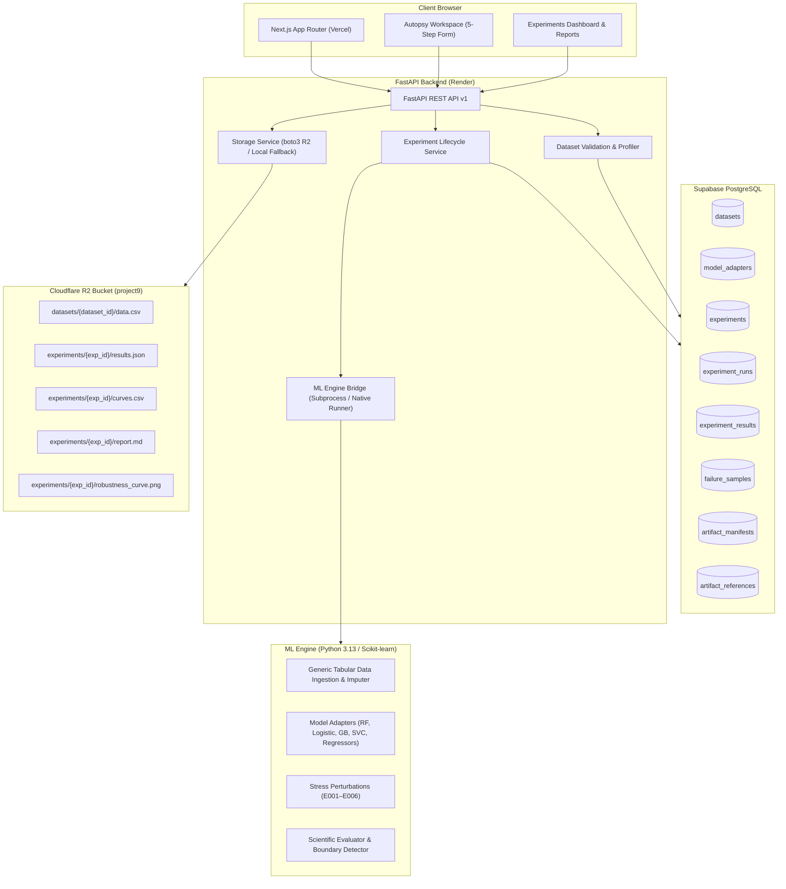

# Complete System Architecture & Defect Audit

**Project:** Model Autopsy — Find Out Why AI Fails  
**Audit Timestamp:** 2026-11-06T23:50:00Z  
**Author:** Senior Full-Stack Architect & ML Infrastructure Engineer  
**Status:** Comprehensive Monorepo Audit Complete  
**Target Commit:** `717dac2`  

---

## 1. Executive Summary

An exhaustive end-to-end audit was conducted across the `frontend/`, `backend/`, `ml_engine/`, `tests/`, and deployment pipelines. The platform's objective is to enable any user to upload a custom tabular dataset (CSV), select a compatible model adapter, compute baseline metrics, execute systematic stress tests (E001–E006 protocols), persist all metadata in Supabase PostgreSQL, store persistent artifacts and raw data in Cloudflare R2, and inspect failure boundaries and vulnerability curves in the browser.

While earlier commits successfully wired Cloudflare R2 and fixed client-side React rendering crashes, a critical architectural gap was identified: **the user workflow from custom CSV upload to model execution was partially simulated or constrained to the Iris benchmark**. 

This audit details the full architectural topology, service dependencies, confirmed root causes for the blank Workspace steps, and the precise engineering roadmap to make the end-to-end platform fully operational with zero fake data and zero Iris-only assumptions.

---

## 2. Service Responsibilities & Dependency Map

---

## 3. Detailed Component Audit

### 3.1 Frontend (`frontend/`)
- **Framework:** Next.js 14.2.15 (App Router, React 18, Tailwind CSS, Framer Motion, Lucide icons).
- **Hosting:** Vercel (`https://model-autopsy-ai.vercel.app`).
- **State Architecture:**
  - `WorkspaceContent` in [`frontend/app/workspace/page.tsx`](file:///c:/Users/ishit/Model-Autopsy/frontend/app/workspace/page.tsx) uses a single unified `WorkspaceConfig` object synchronized to `localStorage` (`model_autopsy_workspace_draft`) and query params (`?step=dataset|model|baseline|stresstest|review`).
  - Validation is managed by Zod schemas in [`frontend/lib/validators.ts`](file:///c:/Users/ishit/Model-Autopsy/frontend/lib/validators.ts) (`Step1Schema` through `Step4Schema`).
- **API Client:** [`frontend/lib/api.ts`](file:///c:/Users/ishit/Model-Autopsy/frontend/lib/api.ts) defaults to live mode (`USE_MOCKS = process.env.NEXT_PUBLIC_USE_MOCKS === 'true'`). All requests proxy through Next.js rewrite rules in [`frontend/next.config.js`](file:///c:/Users/ishit/Model-Autopsy/frontend/next.config.js) to `https://model-autopsy-backend.onrender.com`.

### 3.2 Backend (`backend/`)
- **Framework:** FastAPI with Python 3.13, Pydantic v2, SQLAlchemy 2.0 Async, asyncpg.
- **Hosting:** Render (`https://model-autopsy-backend.onrender.com`).
- **Endpoints:**
  - `GET /health`: Comprehensive service health, database ping, storage provider status.
  - `GET /api/v1/datasets`: Lists benchmark and uploaded custom datasets.
  - `POST /api/v1/datasets/upload`: Multipart CSV upload, server-side profiling, Supabase registration, and Cloudflare R2 upload.
  - `GET /api/v1/datasets/{id}/download`: Streams dataset file with SHA-256 and storage provider headers.
  - `GET /api/v1/models`: Model adapter catalog with framework, task types, and hyperparameter schemas.
  - `GET /api/v1/experiments`: Lists all experiments with degradation, boundaries, and metrics.
  - `POST /api/v1/experiments` or `/run`: Validates config, queues experiment, spawns background ML task.
  - `GET /api/v1/experiments/{id}`: Detailed telemetry, per-seed run status, and degradation curves.
  - `GET /api/v1/experiments/{id}/artifacts/{type}`: Presigned URL redirect or streaming of experiment artifacts.

### 3.3 Database (`Supabase PostgreSQL`)
- **Connection:** `aws-0-ap-northeast-1.pooler.supabase.com:5432/postgres` (SSL mode `require`, SQLAlchemy `asyncpg`).
- **Tables (8 Canonical Tables):**
  1. `datasets`: Metadata, row count, feature count, data types, target column, R2 reference.
  2. `model_adapters`: Registry of preconfigured models with default hyperparameters.
  3. `experiments`: Experiment configuration, status, timestamps, seeds, and execution progress.
  4. `experiment_runs`: Per-seed execution records tracking multi-seed variance.
  5. `experiment_results`: Baseline and worst-case metrics, degradation percentages, observed boundary, curve data JSON, feature vulnerabilities JSON.
  6. `failure_samples`: Sample-level stress test failures, ground truth vs prediction, confidence.
  7. `artifact_manifests`: Immutable JSON audit manifest for reproducibility.
  8. `artifact_references`: R2 object keys, SHA-256 hashes, file sizes, and storage provider attribution.
- **Migrations:** Managed via Alembic (`001_initial_tables.py`).

### 3.4 Object Storage (`Cloudflare R2`)
- **Bucket:** `project9` (Account `916b7f70128acc095b09c70a1c1d6318`, Endpoint `https://916b7f70128acc095b09c70a1c1d6318.r2.cloudflarestorage.com`).
- **Adapter:** `StorageService` in [`backend/app/services/storage_service.py`](file:///c:/Users/ishit/Model-Autopsy/backend/app/services/storage_service.py) wrapping boto3 S3 client.
- **Features:** Atomic downloads, SHA-256 integrity verification, safe key sanitization, presigned GET URLs with configurable expiration, and observable local filesystem fallback when credentials are not supplied.

### 3.5 ML Engine (`ml_engine/`)
- **Protocols:** E001 (Gaussian Noise), E002 (MCAR Missingness), E003 (Outlier Contamination), E004 (Failure Patterns), E005 (Feature Vulnerability), E006 (Covariate Shift).
- **Core Modules:**
  - `analysis/failure_boundary.py`: Multi-threshold failure boundary interpolation.
  - `metrics/evaluator.py`: Stratified scientific evaluation (Macro-F1, Accuracy, Degradation).
  - `visualization/curve_plotter.py`: Research-grade robustness curves.

---

## 4. Confirmed Defects & Root Cause Analysis

| ID | Component | Defect Description | Root Cause | Severity |
|---|---|---|---|---|
| **DEF-01** | `Step1Dataset` & `Backend` | Target column hardcoded to `'target'`; no target selector UI | Backend `DatasetSchema` omitted `targetName`, so frontend never received auto-detected target column. Frontend had hardcoded string `'target'`. | **Critical** |
| **DEF-02** | `Step1Dataset` | Hardcoded "16 missing values detected" in UI | Static markup in `Step1Dataset.tsx` line 228 instead of computing total missing values from actual `features` array. | **Medium** |
| **DEF-03** | `Step2Model` | Step 2 Model rendered completely blank on custom CSV upload | `api.getModels()` returned backend records lacking `taskTypes` (plural array) and `parameters` dictionary. `m.taskTypes.includes()` threw uncaught TypeError during render. | **Critical (Fixed in 717dac2)** |
| **DEF-04** | `Step3Baseline` | Fake `setInterval` timer simulating baseline evaluation | No real baseline evaluation API endpoint existed in FastAPI. Frontend simply incremented a local state counter without training or evaluating the model. | **Critical** |
| **DEF-05** | `Step3Baseline` | Displays classification metrics (F1) for regression tasks | Static hardcoded card labels in `Step3Baseline.tsx` rather than conditionally rendering MAE/RMSE/R² vs Accuracy/F1. | **High** |
| **DEF-06** | `Step4StressTest` | Target features hardcoded to `['Credit Score', 'Income', 'Age', 'Loan Amount']` | `WorkspaceContent` failed to pass `datasetFeatures` from selected dataset to `Step4StressTest`, falling back to mock default prop. | **High** |
| **DEF-07** | `MLEngineBridge` | All experiments execute `e001_runner.py` which hardcodes `load_and_validate_iris()` | Runner scripts ignore `dataset_id` in `config.yaml` and directly invoke Iris dataset loader. Custom CSV datasets cannot execute real stress tests. | **Critical** |
| **DEF-08** | `ExperimentService` | Regression task type defaults silently to classification | `_to_task_type()` caught `ValueError` and defaulted to `TaskType.CLASSIFICATION` without explicit validation. | **Medium** |
| **DEF-09** | `Database/Auth` | Single-tenant assumption without ownership mapping | Tables lack explicit `user_id` foreign keys; single-tenant execution model is currently active. User identity must be handled cleanly. | **Low** |

---

## 5. End-to-End Workflow Repair Plan

### Phase 3 & 4: Dataset Upload, Profiling & Target Selection
1. Update `backend/app/schemas/__init__.py`: Add `target_name: Optional[str] = Field(default=None, alias="targetName")` to `DatasetSchema`.
2. Update `_dataset_to_schema()` in `backend/app/api/v1/endpoints/datasets.py`: Return `targetName=dataset.target_name`.
3. In `frontend/components/workspace/Step1Dataset.tsx`:
   - Replace hardcoded `'target'` with a dynamic **Target Column Dropdown** listing all columns from `uploadedSchema.features`.
   - Add a **Task Type Selector** (`classification` vs `regression`) with auto-detection based on unique class count.
   - Compute real total missing values from `features.reduce((acc, f) => acc + (f.missingCount || 0), 0)`.
   - Ensure `onSelectDataset` passes `targetColumn`, `taskType`, and feature names to `WorkspaceConfig`.

### Phase 5: Dynamic Model Discovery
- Verify `Step2Model` (hardened in `717dac2`) correctly pairs with classification and regression models:
  - Classification: Random Forest, Logistic Regression, Gradient Boosting, SVC.
  - Regression: Linear Regression, Ridge Regression, Random Forest Regressor.

### Phase 6: Baseline Evaluation Pipeline
1. Create new FastAPI endpoint: `POST /api/v1/experiments/baseline`
   - Accepts: `dataset_id`, `model_id`, `task_type`, `test_size`, `seed`, `target_name`, `model_params`.
   - Ingestion: Loads dataset from Cloudflare R2 / local cache.
   - Processing: Handles missing values, encodes categoricals, splits train/test with stratification.
   - Model Training: Fits scikit-learn model with specified hyperparameters.
   - Evaluation: Computes real metrics:
     - Classification: Accuracy, Precision, Recall, Macro-F1, Confusion Matrix.
     - Regression: MAE, MSE, RMSE, R².
   - Returns real baseline metrics dictionary.
2. In `frontend/components/workspace/Step3Baseline.tsx`:
   - Replace fake `setInterval` with real `api.evaluateBaseline(config)`.
   - Display real metric cards conditionally based on `taskType`.

### Phase 7 & 9: Generic Custom Dataset ML Runner
1. In `ml_engine/src/model_autopsy/datasets/`:
   - Create `tabular_loader.py`: `load_tabular_dataset(csv_path, target_col, task_type, test_size, seed)` returning immutable train/test bundle, feature dispersion `train_std`, and feature names.
2. In `ml_engine/src/model_autopsy/experiments/custom_runner.py`:
   - Orchestrate real multi-seed stress testing on ANY tabular dataset using the requested model adapter and perturbation family (Gaussian noise, missingness, etc.).
3. Update `backend/app/services/ml_engine_bridge.py`:
   - Route custom uploaded datasets to `custom_runner.py` while preserving existing E001–E006 benchmark protocols for `iris` and `german-credit`.

### Phase 8: Pass Dataset Features to Step 4
- In `frontend/app/workspace/page.tsx`:
  - Pass `datasetFeatures={config.features?.map(f => f.name) || []}` to `Step4StressTest`.

---

## 6. Security & Stability Guardrails
- **Credential Safety:** Server-side boto3 credentials (`R2_ACCESS_KEY_ID`, `R2_SECRET_ACCESS_KEY`) remain strictly in Render environment variables; never exposed to browser or bundled in Next.js client assets.
- **Path Traversal Prevention:** Dataset keys are validated using alphanumeric sanitization (`re.sub(r'[^a-zA-Z0-9_\-\.]', '_', filename)`); directory traversal (`../`) is rejected.
- **Resource Limits:** Uploaded CSV size is capped at 25 MB on both client and FastAPI `UploadFile` stream. Concurrency is limited to 2 simultaneous background ML executions to avoid Render memory limits.
- **Data Preservation:** Zero destructive database operations; zero table drops; existing E001–E006 benchmarks and live experiment records in Supabase remain untouched.

