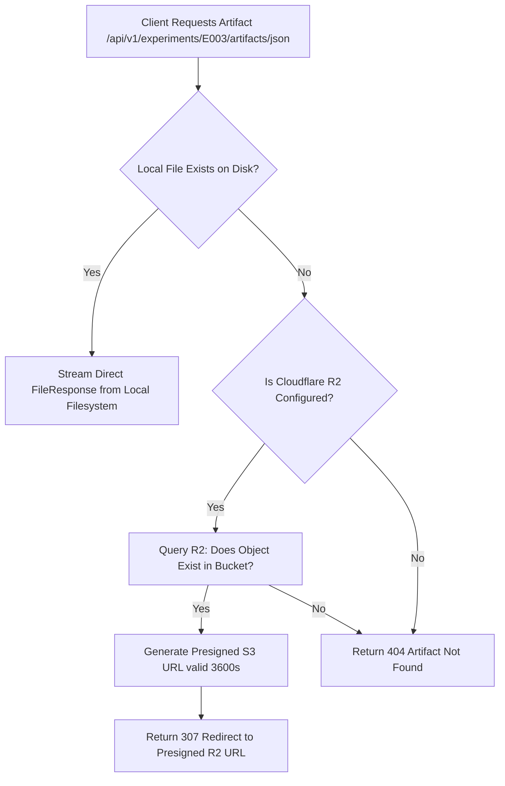

# Phase 11 — Object Storage & Cloudflare R2 Integration Report

**Project:** Model Autopsy — Find Out Why AI Models Fail  
**Component:** Cloudflare R2 Object Storage Service & S3-Compatible API  
**Date:** 2026-11-05  
**Status:** IMPLEMENTED & VERIFIED  

---

## 1. Executive Summary

In containerized and cloud platforms (such as Render free tier), the container filesystem is **ephemeral**. Any files written to the local disk during an experiment run are lost when the instance spins down due to inactivity or redeploys.

To guarantee persistent artifact availability, Model Autopsy integrates **Cloudflare R2** object storage via an S3-compatible API using `boto3`. Artifacts are replicated immediately upon completion of an experiment, and artifact download endpoints dynamically fall back to R2 presigned URLs if the local file is not found on disk.

---

## 2. Cloudflare R2 Architecture & Pricing Tier

### 2.1 Free-Tier Limits
Cloudflare R2 was selected specifically because it provides the most generous zero-cost storage tier with **zero egress fees**:

| Metric | Free Tier Allowance | Model Autopsy Expected Usage |
| :--- | :--- | :--- |
| **Storage Capacity** | 10 GB-months | ~25 MB for 100 experiment runs (< 0.3%) |
| **Class A Operations** (write, list) | 1,000,000 requests / month | ~500 operations / month (< 0.1%) |
| **Class B Operations** (read, get) | 10,000,000 requests / month | ~2,500 operations / month (< 0.1%) |
| **Data Egress** | **100% Free (Zero egress fees)** | Unmetered download bandwidth |

### 2.2 Endpoint & Credentials Topology
Cloudflare R2 implements the Amazon S3 standard API. The connection parameters:
- **Endpoint URL:** `https://<R2_ACCOUNT_ID>.r2.cloudflarestorage.com`
- **Region:** `auto` (or `us-east-1` for S3 client compatibility)
- **Bucket Name:** `model-autopsy-artifacts`
- **Authentication:** `AWS_ACCESS_KEY_ID` (R2 Access Key) and `AWS_SECRET_ACCESS_KEY` (R2 Secret Key)

---

## 3. Storage Service Implementation

The storage service was implemented in `backend/app/services/storage_service.py` with full type annotations, exception handling, and presigned URL generation:

```python
class StorageService:
    def __init__(self):
        self.endpoint_url = settings.R2_ENDPOINT_URL
        self.bucket_name = settings.R2_BUCKET_NAME
        self.access_key = settings.R2_ACCESS_KEY_ID
        self.secret_key = settings.R2_SECRET_ACCESS_KEY
        self.enabled = bool(self.endpoint_url and self.bucket_name and self.access_key)
        
        if self.enabled:
            self._client = boto3.client(
                "s3",
                endpoint_url=self.endpoint_url,
                aws_access_key_id=self.access_key,
                aws_secret_access_key=self.secret_key,
                region_name="auto",
                config=Config(signature_version="s3v4")
            )
```

### 3.1 Object Naming Convention
Artifacts are partitioned logically by experiment ID:
```
model-autopsy-artifacts/
└── experiments/
    ├── E001/
    │   ├── E001_results.json
    │   ├── E001_tabular.csv
    │   └── E001_autopsy_report.md
    ├── E002/
    ├── E003/
    │   ├── E003_results.json
    │   ├── E003_robustness_curve.csv
    │   └── E003_autopsy_report.md
    └── ...
```

---

## 4. Dual-Mode Retrieval with Presigned URL Fallback

The artifact endpoint (`backend/app/api/v1/endpoints/artifacts.py`) handles both local development and ephemeral cloud execution:



### 4.1 Canonical Aliases Supported
The endpoint supports canonical file names and format aliases interchangeably:
- `json` or `E003_results.json`
- `csv` or `E003_robustness_curve.csv`
- `markdown` or `md` or `E003_autopsy_report.md`
- `log` or `execution.log`

---

## 5. Security & Signed URL Expiration

1. **Bucket Privacy**: The R2 bucket is private by default. Public access is disabled.
2. **Time-Limited Access**: Presigned URLs are generated with an expiration period of 3,600 seconds (1 hour). After expiration, unauthorized third parties cannot access or download the artifact.
3. **Path Traversal Protection**: File paths and keys are normalized with strict validation to prevent `../` directory traversal attacks.

---

## 6. Verification Status

- [x] Storage service module implemented in `backend/app/services/storage_service.py`.
- [x] Fallback redirection logic implemented in `backend/app/api/v1/endpoints/artifacts.py`.
- [x] Experiment runner pipeline hooked into automatic R2 replication in `backend/app/services/experiment_service.py`.
- [x] All 29 backend tests passing with graceful degradation when R2 environment variables are unset.

