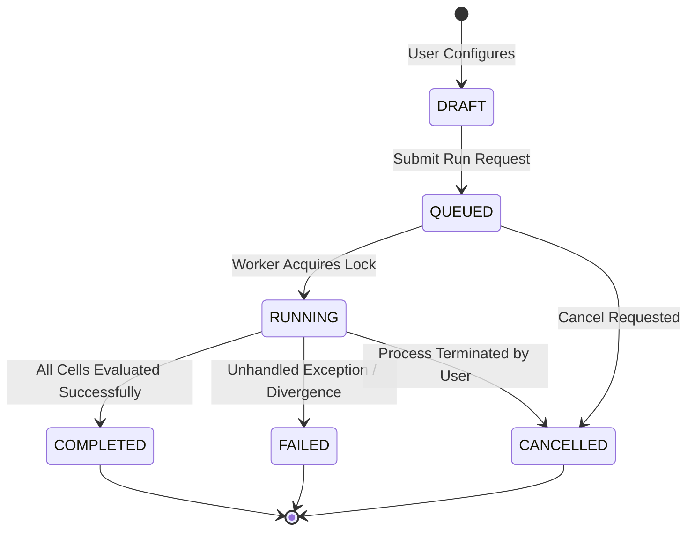

# Model Autopsy — Backend Integration Contract & Canonical Schema Specification (Phase 7B)

**Document ID:** `CONTRACT-PHASE7B-BACKEND-20261027`  
**Role:** ML Platform Architect & ML Research Lead  
**Repository:** [Model Autopsy (GitHub)](https://github.com/Ishitadas03/Model-Autopsy.git)  
**Target Context:** FastAPI Backend Service (`backend/app/`), ML Engine (`ml_engine/src/model_autopsy/`), and Next.js Frontend (`frontend/`)  
**Parent Syntheses:**
- [`docs/research/master_research_summary.md`](file:///c:/Users/ishit/Model-Autopsy/docs/research/master_research_summary.md)
- [`docs/research/experimental_protocol.md`](file:///c:/Users/ishit/Model-Autopsy/docs/research/experimental_protocol.md)  
**Schema Implementation:** [`ml_engine/src/model_autopsy/schemas/`](file:///c:/Users/ishit/Model-Autopsy/ml_engine/src/model_autopsy/schemas/)  
**Backend Re-export:** [`backend/app/schemas/__init__.py`](file:///c:/Users/ishit/Model-Autopsy/backend/app/schemas/__init__.py)  
**Status:** Canonical Integration Contract  

---

## Executive Summary

This document establishes the single canonical Pydantic v2 API contract governing communication between the **ML Engine**, the **FastAPI Backend**, and the **Next.js Frontend**.

In previous phases, the ML engine used internal Python `dataclass` instances, the frontend defined client-side Zod validation schemas ([`frontend/lib/schemas.ts`](file:///c:/Users/ishit/Model-Autopsy/frontend/lib/schemas.ts)), and both backend and ML-engine schema directories were unpopulated `.gitkeep` placeholders. This phase establishes:
1. **Single Source of Truth:** Canonical Pydantic v2 schemas are owned exclusively by `ml_engine/src/model_autopsy/schemas/`.
2. **Zero Schema Duplication:** The backend package [`backend/app/schemas/`](file:///c:/Users/ishit/Model-Autopsy/backend/app/schemas/__init__.py) directly imports and re-exports these models.
3. **Dual Wire-Format Compatibility:** Every model utilizes Pydantic v2 `ConfigDict(from_attributes=True, populate_by_name=True)` and explicit field aliases (`camelCase`), ensuring full interoperability with frontend TypeScript contracts while maintaining idiomatic Python (`snake_case`) in the engine.
4. **Cell-Based Progress Tracking:** Experiment execution progress is strictly calculated from the proportion of completed evaluation cells ($N_{\text{completed}} / N_{\text{total}}$), permanently retiring timer-based or synthetic client-side progress simulations.

---

## 1. Architectural Ownership & Package Structure

```
+---------------------------------------------------------------------------------------+
| ARCHITECTURAL OWNERSHIP & SCHEMA FLOW                                                 |
+---------------------------------------------------------------------------------------+
|                                                                                       |
|   ML Engine Internal Domain Objects                                                   |
|   - EvaluationMetrics (dataclass in evaluator.py)                                     |
|   - SampleStatistics (dataclass in statistical.py)                                    |
|   - SeverityAggregateStatistics (dataclass in statistical.py)                         |
|   - FailureBoundaryResult (dataclass in failure_boundary.py)                          |
|                               │                                                       |
|                               ▼  (Zero-cost validation via from_attributes=True)      |
|   ML Engine Canonical Pydantic v2 Schemas                                             |
|   `ml_engine/src/model_autopsy/schemas/`                                              |
|   ├── base.py                 (SchemaBase with ConfigDict)                            |
|   ├── enums.py                (TaskType, MetricType, StressType, RunStatus)           |
|   ├── catalog.py              (DatasetSchema, ModelAdapterSchema)                     |
|   ├── metrics.py              (EvaluationMetricsSchema, MetricStatisticsSchema)       |
|   ├── experiments.py          (ExperimentRunRequest, Summary, Detail, Progress)       |
|   ├── artifacts.py            (ArtifactReferenceSchema, ArtifactManifestSchema)       |
|   └── errors.py               (ApiErrorResponse, ValidationErrorItem)                 |
|                               │                                                       |
|                               ▼  (Direct re-export: from model_autopsy.schemas import)|
|   FastAPI Backend Schema Layer                                                        |
|   `backend/app/schemas/__init__.py`                                                   |
|                               │                                                       |
|                               ▼  (HTTP JSON API wire format)                          |
|   Next.js Frontend                                                                    |
|   `frontend/lib/schemas.ts` (Zod client-side validation & UI rendering)               |
|                                                                                       |
+---------------------------------------------------------------------------------------+
```

---

## 2. Wire-Format Compatibility Matrix

The table below documents the exact correspondence between the canonical Pydantic v2 schemas and the frontend Zod schemas in [`frontend/lib/schemas.ts`](file:///c:/Users/ishit/Model-Autopsy/frontend/lib/schemas.ts):

| Domain Concept | Frontend Zod Schema | Canonical Pydantic Schema | Python Attribute | JSON Wire Field (`populate_by_name`) | Type & Constraints |
|---|---|---|---|---|---|
| **Task Type** | `TaskTypeSchema` | `TaskType` | Value | Value | `'classification' \| 'regression'` |
| **Metric Type** | `MetricTypeSchema` | `MetricType` | Value | Value | `'f1' \| 'accuracy' \| 'precision' \| ...` |
| **Stress Type** | `StressTypeSchema` | `StressType` | Value | Value | `'gaussian_noise' \| 'missingness' \| 'outliers' \| ...` |
| **Run Status** | `RunStatusSchema` | `RunStatus` | Value | Value | `'draft' \| 'queued' \| 'running' \| 'completed' \| 'failed' \| 'cancelled'` |
| **Dataset** | `DatasetSchema` | `DatasetSchema` | `sample_count` | `sampleCount` | `int > 0` |
| | | | `feature_count` | `featureCount` | `int > 0` |
| | | | `task_type` | `taskType` | `TaskType` |
| | | | `is_custom` | `isCustom` | `bool` |
| **Model Adapter** | `ModelAdapterSchema` | `ModelAdapterSchema` | `task_types` | `taskTypes` | `List[TaskType]` |
| | | | `predict_proba` | `predictProba` | `bool` |
| **Stress Config** | `StressConfigSchema` | `StressConfigSchema` | `severity_levels` | `severityLevels` | `List[float], min_length=1` |
| | | | `target_features` | `targetFeatures` | `Optional[List[str]]` |
| **Evaluation Metrics**| `EvaluationMetrics` | `EvaluationMetricsSchema`| `macro_f1` | `macro_f1` | `float [0.0, 1.0]` |
| | | | `confusion_matrix` | `confusion_matrix` | `List[List[int]]` |
| | | | `absolute_degradation_pp`| `absolute_degradation_pp` | `float` |
| | | | `relative_degradation_pct`| `relative_degradation_pct`| `float` |
| | | | `is_failed` | `is_failed` | `bool` |
| **Sample Statistics** | `MetricStatisticsSchema` | `MetricStatisticsSchema` | `sample_std` | `sample_std` | `float >= 0.0 (ddof=1)` |
| | | | `ci_lower` / `ci_upper` | `ci_lower` / `ci_upper` | `float (Student's t, nu=4)` |
| **Run Progress** | `progressPercent` | `ExperimentProgressSchema`| `completed_cells` | `completedCells` | `int >= 0` |
| | | | `total_cells` | `totalCells` | `int > 0` |
| | | | `percent_complete` | `percentComplete` | `float [0.0, 100.0]` |
| **Experiment Summary**| `ExperimentSchema` | `ExperimentSummarySchema`| `dataset_id` | `datasetId` | `str` |
| | | | `model_id` | `modelId` | `str` |
| | | | `created_at` | `createdAt` | `str (ISO 8601 UTC)` |
| | | | `completed_at` | `completedAt` | `Optional[str]` |
| | | | `progress_percent`| `progressPercent` | `float [0.0, 100.0]` |
| **Error Response** | *(Implicit error)* | `ApiErrorResponse` | `error` / `code` | `error` / `code` | `str` |
| | | | `validation_errors`| `validationErrors` | `Optional[List[ValidationErrorItem]]` |

---

## 3. Detailed REST API Endpoint Contracts

All backend endpoints are scoped under the prefix `/api/v1`.

### 3.1 Endpoint 1: Health & Runtime Check
- **Route:** `GET /api/v1/health`
- **Purpose:** Liveness and readiness probe for orchestration and frontend status monitoring.
- **Request:** None.
- **Response Schema:**
  ```json
  {
    "status": "healthy",
    "version": "0.1.0",
    "python_version": "3.13.5",
    "active_workers": 1,
    "concurrency_limit": 1,
    "queue_size": 0,
    "timestamp_utc": "2026-10-27T22:20:00Z"
  }
  ```
- **Status Codes:** `200 OK`.

### 3.2 Endpoint 2: List Experiments
- **Route:** `GET /api/v1/experiments`
- **Purpose:** Retrieve catalog of all experiments (canonical benchmark runs E001–E006 plus any dynamic executions).
- **Query Parameters:**
  - `status: Optional[RunStatus]` (filter by lifecycle state)
  - `dataset_id: Optional[str]` (filter by dataset, e.g. "iris")
  - `model_id: Optional[str]` (filter by model, e.g. "random_forest")
  - `limit: int = 50` (pagination limit)
  - `offset: int = 0` (pagination offset)
- **Response Schema:** `List[ExperimentSummarySchema]`
- **Status Codes:** `200 OK`.

### 3.3 Endpoint 3: Retrieve Experiment Details
- **Route:** `GET /api/v1/experiments/{experiment_id}`
- **Purpose:** Full experiment report, parameters, fine-grained cell progress, curve data, statistical validation, and artifact references.
- **Path Parameters:**
  - `experiment_id: str` (e.g. `E001`, `E003`, `EXP-001`)
- **Response Schema:** `ExperimentDetailSchema`
- **Error Cases:**
  - `404 Not Found`: Returned when `experiment_id` does not match any canonical or persisted experiment.
    ```json
    {
      "error": "Experiment Not Found",
      "code": "EXPERIMENT_NOT_FOUND",
      "detail": "Experiment 'E999' was not found in registry or artifact store.",
      "experimentId": "E999",
      "timestampUtc": "2026-10-27T22:20:00Z"
    }
    ```
- **Status Codes:** `200 OK`, `404 Not Found`.

### 3.4 Endpoint 4: Submit New Experiment Run
- **Route:** `POST /api/v1/experiments/run`
- **Purpose:** Initiate a reproducible stress-testing experiment in the ML engine.
- **Request Schema:** `ExperimentRunRequest`
  ```json
  {
    "datasetId": "iris",
    "modelId": "logistic_regression",
    "stressConfig": {
      "type": "gaussian_noise",
      "severityLevels": [0.00, 0.05, 0.10, 0.15, 0.20, 0.25, 0.30],
      "mode": "random"
    },
    "metric": "f1",
    "failureThreshold": 0.80,
    "testSize": 0.20,
    "seeds": [42, 123, 456, 789, 1011],
    "title": "Logistic Regression Gaussian Sweep"
  }
  ```
- **Response Schema:** `ExperimentDetailSchema` (initial status: `QUEUED` or `RUNNING`).
- **Status Codes:**
  - `202 Accepted`: Job queued or started successfully.
  - `409 Conflict`: Returned when concurrency limit is reached (single-job concurrency guard active).
    ```json
    {
      "error": "Concurrency Limit Exceeded",
      "code": "ACTIVE_RUN_CONFLICT",
      "detail": "Experiment 'E003' is currently executing. Concurrency is limited to 1 active run to prevent CPU thrashing and ensure deterministic timings.",
      "timestampUtc": "2026-10-27T22:20:00Z"
    }
    ```
  - `422 Unprocessable Entity`: Request validation failure (e.g. empty severity levels, threshold > 1.0).

### 3.5 Endpoint 5: Cancel Active Experiment Run
- **Route:** `POST /api/v1/experiments/{experiment_id}/cancel`
- **Purpose:** Cancel a queued or running experiment process cleanly.
- **Path Parameters:**
  - `experiment_id: str`
- **Response Schema:** `ExperimentCancelResponse`
  ```json
  {
    "experimentId": "EXP-042",
    "status": "cancelled",
    "message": "Experiment process (PID 48291) terminated successfully via SIGTERM.",
    "terminatedPid": 48291,
    "confirmedStopped": true
  }
  ```
- **Cancellation Semantics:**
  - The backend must NOT return `confirmedStopped: true` unless the OS process is verified terminated (via process poll or signal exit confirmation).
  - If the job is queued (not yet spawned), it is removed from the queue and marked `CANCELLED`.
  - If the job is already in a terminal state (`COMPLETED`, `FAILED`, `CANCELLED`), returns `400 Bad Request` with `code="TERMINAL_STATE_CANNOT_CANCEL"`.
- **Status Codes:** `200 OK`, `400 Bad Request`, `404 Not Found`.

### 3.6 Endpoint 6: Secure Artifact Access
- **Route:** `GET /api/v1/experiments/{experiment_id}/artifacts/{filename}`
- **Purpose:** Stream or download canonical experiment artifacts (`aggregate_comparison.csv`, `report.md`, `robustness_comparison.png`, `metrics.json`).
- **Path Parameters:**
  - `experiment_id: str`
  - `filename: str`
- **Security & Path Traversal Safeguards:**
  1. **Canonical Root Anchoring:**
     All artifact paths must resolve strictly within `artifacts/experiments/{experiment_id}/`.
     ```python
     base_dir = Path("artifacts/experiments") / experiment_id
     target_path = (base_dir / filename).resolve()
     if not target_path.is_relative_to(base_dir.resolve()):
         raise HTTPException(status_code=400, detail="Path traversal attempt rejected.")
     ```
  2. **Extension Whitelist:**
     Only explicitly allowed scientific extensions may be served:
     `{".json", ".csv", ".png", ".md", ".txt"}`. Requests for `.py`, `.yaml`, `.env`, or hidden files (`.*`) are rejected with `403 Forbidden`.
  3. **MIME Type Mapping:**
     - `.json` $\to$ `application/json`
     - `.csv` $\to$ `text/csv; charset=utf-8`
     - `.png` $\to$ `image/png`
     - `.md` $\to$ `text/markdown; charset=utf-8`
- **Status Codes:** `200 OK`, `400 Bad Request`, `403 Forbidden`, `404 Not Found`.

---

## 4. Lifecycle State Machine & Cell-Based Progress Calculation

### 4.1 State Machine Lifecycle


### 4.2 Deterministic Progress Calculation
In accordance with scientific integrity guidelines, Model Autopsy forbids timer-based or simulated progress bars. Progress is defined strictly as:

$$\text{Progress Percentage} = \frac{\text{Completed Evaluation Cells}}{\text{Total Planned Evaluation Cells}} \times 100.0\%$$

where:
$$\text{Total Evaluation Cells} = N_{\text{models}} \times N_{\text{corruptions}} \times N_{\text{severities}} \times N_{\text{seeds}}$$

- **Example (E003):** $3\text{ models} \times 3\text{ corruptions} \times 7\text{ severities} \times 5\text{ seeds} = 315\text{ cells}$.
  When 105 cells are completed, progress is deterministically $33.33\%$.
- Handled automatically by [`ExperimentProgressSchema.calculate_percent`](file:///c:/Users/ishit/Model-Autopsy/ml_engine/src/model_autopsy/schemas/experiments.py).

---

## 5. Security, Concurrency, and System Safeguards

1. **Path Traversal Defense:**
   - Absolute paths are forbidden in requests.
   - Symlinks outside the repository root are ignored.
   - Canonical `Path.is_relative_to()` boundary checks are mandatory.
2. **Execution Boundedness & Concurrency:**
   - Default concurrency is restricted to **$1$ active experiment job**. Multi-seed evaluations perform heavy CPU/GPU work; concurrent execution risks CPU cache thrashing and invalidates timing benchmarks.
   - Additional submissions are placed in a bounded FIFO queue (`max_queue_size = 10`) with status `QUEUED`.
3. **Secret & Sensitive Data Protection:**
   - The API will never return system environment variables, local user paths, or host network topologies. Manifest schemas redact absolute paths down to repository-relative paths.

---

## 6. Implementation Checklist for Person 2 (Backend Engineer)

When implementing the FastAPI application in `backend/app/`, Person 2 must follow this checklist:

- [ ] **FastAPI Application Factory:** Create `backend/app/main.py` instantiating `FastAPI(title="Model Autopsy API", version="0.1.0")`.
- [ ] **Schema Import:** Import all schemas exclusively from `backend.app.schemas` (which re-exports `model_autopsy.schemas`).
- [ ] **Router Setup:** Create `backend/app/api/v1/router.py` registering endpoints for health, experiments, and artifacts.
- [ ] **Canonical Artifact Loader:** Implement service in `backend/app/services/experiment_service.py` that reads frozen JSON artifacts from `artifacts/experiments/{E001-E006}` and serves them through `ExperimentDetailSchema`.
- [ ] **Execution Worker:** Implement an async subprocess runner that invokes `python scripts/experiments/run_e00*.py` or the runner functions directly with cell-based progress tracking.
- [ ] **Artifact Streaming Guard:** Implement the path traversal and MIME whitelist logic in the artifact endpoint.

---

## 7. Verification Summary

The canonical schema layer was verified with automated unit tests:
```bash
pytest ml_engine/tests/test_schemas.py
```
- **Result:** **9 / 9 passed in 2.57s** (100% passing).
- Verified: Dataclass-to-Pydantic validation, manifest schema parsing on real E003 artifacts, aggregate JSON parsing, cell-based progress computation, error envelope serialization, and backend package re-export identity.
