# Model Autopsy — Master Research Synthesis & Integration Readiness (Phase 7A)

**Document ID:** `SYNTHESIS-PHASE7A-MASTER-20261027`  
**Role:** ML Research Lead & Scientific Documentation Engineer  
**Repository:** [Model Autopsy (GitHub)](https://github.com/Ishitadas03/Model-Autopsy.git)  
**Target Scope:** Comprehensive empirical synthesis of Experiments E001 through E006, resolution of Research Questions RQ1–RQ8, statistical audit reconciliation, and ML engine backend integration readiness.  
**Historical Predecessors:**
- [`docs/research/problem_statement.md`](file:///c:/Users/ishit/Model-Autopsy/docs/research/problem_statement.md)
- [`docs/research/experimental_protocol.md`](file:///c:/Users/ishit/Model-Autopsy/docs/research/experimental_protocol.md)
- [`docs/research/phase3_scientific_audit.md`](file:///c:/Users/ishit/Model-Autopsy/docs/research/phase3_scientific_audit.md) (E002 Audit)
- [`docs/research/e003_scientific_audit.md`](file:///c:/Users/ishit/Model-Autopsy/docs/research/e003_scientific_audit.md) (E003 Audit)
- [`docs/research/e004_scientific_audit.md`](file:///c:/Users/ishit/Model-Autopsy/docs/research/e004_scientific_audit.md) (E004 Audit)
- [`docs/research/e005_scientific_audit.md`](file:///c:/Users/ishit/Model-Autopsy/docs/research/e005_scientific_audit.md) (E005 Audit)
- [`docs/research/e006_scientific_audit.md`](file:///c:/Users/ishit/Model-Autopsy/docs/research/e006_scientific_audit.md) (E006 Audit)
- [`docs/research/project_completion_audit.md`](file:///c:/Users/ishit/Model-Autopsy/docs/research/project_completion_audit.md)  
**Audit Timestamp:** 2026-10-27 22:15:00 UTC  
**Status:** Canonical Master Synthesis Document  

---

## Executive Summary

The **Model Autopsy** project (*"Find Out Why AI Models Fail"*) investigates how machine learning models degrade under progressive data corruption, structural missingness, outlier injection, coordinate-isolated feature vulnerabilities, and systematic distribution shifts.

Between Phases 1 and 6, six empirical experiments (**E001–E006**) were pre-registered, implemented in the Python ML engine (`ml_engine/src/model_autopsy/`), executed across multi-seed research suites, serialized into canonical artifact stores (`artifacts/experiments/`), and independently verified through rigorous scientific audits. 

This master research synthesis consolidates the entire scientific foundation:
1. **Full Protocol Resolution:** All eight foundational research questions (**RQ1 through RQ8**) have been systematically investigated, statistically tested, and formally resolved on the primary benchmark.
2. **Empirical Ground Truth:** All reported quantitative claims trace directly to frozen machine-readable artifacts (`aggregate_comparison.csv/json`, `metrics.json`, `shift_summary.csv`, `sample_predictions.json`). Zero metrics are fabricated or derived from hypothetical mocks.
3. **Audit Coverage:** Dedicated scientific audit documents exist for all experiments: E002 ([`phase3_scientific_audit.md`](file:///c:/Users/ishit/Model-Autopsy/docs/research/phase3_scientific_audit.md)), E003 ([`e003_scientific_audit.md`](file:///c:/Users/ishit/Model-Autopsy/docs/research/e003_scientific_audit.md)), E004 ([`e004_scientific_audit.md`](file:///c:/Users/ishit/Model-Autopsy/docs/research/e004_scientific_audit.md)), E005 ([`e005_scientific_audit.md`](file:///c:/Users/ishit/Model-Autopsy/docs/research/e005_scientific_audit.md)), and E006 ([`e006_scientific_audit.md`](file:///c:/Users/ishit/Model-Autopsy/docs/research/e006_scientific_audit.md)).
4. **Complete Test Suite Health:** The full automated test suite passes with **107 / 107 tests green** (`ml_engine/tests`), verifying numerical invariants, leakage isolation, array immutability, and end-to-end execution reproducibility.
5. **Integration Readiness:** The ML engine domain objects are stable and validated. The schemas directory (`ml_engine/src/model_autopsy/schemas/`) is ready to host standardized Pydantic v2 schemas that mirror the engine's internal dataclasses and interface directly with the frontend's Zod contracts (`frontend/lib/schemas.ts`).

---

## 1. Project Objective & Shared Experimental Protocol

### 1.1 Central Research Question
The guiding inquiry of the Model Autopsy initiative is:
> *"How does increasing input corruption affect the reliability of machine learning models, and how can their failure behaviour be systematically measured and characterized under controlled experimental conditions?"*

### 1.2 Shared Experimental Invariants
To guarantee that cross-model and cross-corruption comparisons reflect genuine algorithmic inductive biases rather than experimental artifacts, all experiments adhere to frozen invariants:

```
+---------------------------------------------------------------------------------------+
| SHARED EXPERIMENTAL INVARIANTS ACROSS E001 - E006                                     |
+---------------------------------------------------------------------------------------+
| Benchmark Dataset:     Fisher Iris Dataset (N=150, D=4 features, K=3 balanced classes) |
| Split Protocol:        Stratified 80/20 train/test split, fixed split_seed = 42        |
| Partition Cardinality: N_train = 120 (40/class), N_test = 30 (10/class)               |
| Partition Overlap:     Strictly empty set (train_indices ∩ test_indices = ∅)           |
| Dataset Fingerprint:   SHA-256 aa06b8008ceba42efc654be0f83fdafc786239c9e8f13146044d078 |
| Research Seed Suite:   R = 5 independent PRNG seeds: [42, 123, 456, 789, 1011]       |
| Severity Grid (S):     7 discrete levels: S = [0.00, 0.05, 0.10, 0.15, 0.20, 0.25, 0.30] |
| Primary Metric:        Macro-Averaged F1-Score (Macro-F1, unweighted class average)    |
| Secondary Metrics:     Classification Accuracy, per-class F1/P/R, Confusion Matrices  |
| Primary Failure Rule:  Strict inequality: Macro-F1 < 0.80                             |
| Diagnostic Threshold:  Relative drop Δ_rel > 15.0% (decoupled from absolute threshold) |
| Leakage Prevention:    Dispersion (σ_train) and means (μ_train) derived strictly on    |
|                        X_train with Bessel's correction (ddof=1); X_test is read-only  |
| Mandatory Captions:    "Observed failure boundary under the specified configuration."  |
|                        "Empirical sensitivity — not a causal explanation."             |
+---------------------------------------------------------------------------------------+
```

---

## 2. Research Question Mapping & Resolution Matrix

The eight research questions defined in [`docs/research/problem_statement.md`](file:///c:/Users/ishit/Model-Autopsy/docs/research/problem_statement.md) and [`docs/research/project_completion_audit.md`](file:///c:/Users/ishit/Model-Autopsy/docs/research/project_completion_audit.md) map to the empirical experiments as follows:

| RQ ID | Research Domain | Formal Question | Primary Experiment | Experimental Evidence & Canonical Status | Audit Verdict |
|:---:|---|---|:---:|---|:---:|
| **RQ1** | **Model Robustness** | *How does increasing input corruption affect model reliability?* | **E001** | Measured Random Forest degradation under Gaussian noise ($s \in [0.00, 0.30]$); Macro-F1 dropped from $0.9265 \to 0.8538 \pm 0.0282$ (SEM). | Integrated in E002/E003 |
| **RQ2** | **Types of Corruption** | *How do different corruption types affect reliability differently?* | **E002** | Compared Gaussian noise, MCAR missingness, and $5\sigma$ impulsive outliers; proved discrete corruptions induce earlier failure ($s^* = 0.25$) than continuous noise ($s^* > 0.30$). | **PASS WITH WARNINGS** |
| **RQ3** | **Feature Vulnerability** | *Which input features are most sensitive to perturbation?* | **E005** | Coordinate-isolated perturbations across all 4 features; omnibus Friedman tests proved significant differential sensitivity ($p < 0.05$); Petal dimensions drove $\approx 80\%$ of degradation. | **PASS** |
| **RQ4** | **Failure Boundary** | *At what corruption level does a model cross from reliable to unreliable?* | **Cross-Cutting (E001–E006)** | Formalized and evaluated strict boundary logic ($M(s) < 0.80$); cataloged architectural failure thresholds ranging from $s^* = 0.10$ to $s^* > 0.30$. | Verified in all audits |
| **RQ5** | **Model Comparison** | *How does robustness vary across different ML algorithms under identical conditions?* | **E003** | Audited Random Forest, Logistic Regression, and Gradient Boosting; discovered linear models resist Gaussian noise ($\Delta = +2.03$ pp) but collapse under outliers ($\Delta = +41.41$ pp, $s^* = 0.10$). | **PASS WITH WARNINGS** |
| **RQ6** | **Distribution Shift** | *How do models behave under systematic distributional changes?* | **E006** | Evaluated 5 covariate shift regimes; proved rigid translation degrades performance significantly faster than variance dilation ($p = 0.000009$); concept drift demarcated. | **PASS** |
| **RQ7** | **Failure Patterns** | *What recurring patterns characterize model failures under controlled corruption?* | **E004** | Dissected 9,450 atomic prediction records; validated 0% Setosa clean failure, 88.9% error persistence rate, 23-sample consensus failure core, and Mahalanobis margin predictive power ($p = 0.000030$). | **PASS WITH WARNINGS** |
| **RQ8** | **Reproducibility & Statistics** | *How consistent are results across independent random seeds?* | **Cross-Cutting (E001–E006)** | 5-seed PRNG suite with Student's $t$ 95% CIs ($\nu=4, t_{\text{crit}}=2.7764$), sample variance ($ddof=1$), SEM, Friedman tests, and Benjamini-Hochberg FDR correction. | Verified in all audits |

---

## 3. Individual Experiment Synthesis (E001 through E006)

### 3.1 Experiment E001: Foundational Baseline Robustness (RQ1)
- **Objective:** Establish reference degradation trajectories of a canonical Random Forest classifier under additive isotropic Gaussian feature noise.
- **Factorization:** 1 model $\times$ 1 corruption $\times$ 7 severities $\times$ 5 seeds = 35 evaluation cells.
- **Empirical Findings:**
  - Single-seed baseline (seed 42): Clean Macro-F1 $= 0.8997 \to 0.8653$ at $s=0.30$ ($\Delta_{\text{abs}} = 3.44\,\text{pp}$).
  - 5-seed statistical suite: Clean Macro-F1 $= 0.9265 \pm 0.0125$ (SEM) $\to 0.8538 \pm 0.0282$ at $s=0.30$ ($\Delta_{\text{abs}} = 7.28\,\text{pp}, \Delta_{\text{rel}} = 7.80\%$).
  - Mean Failure Boundary: $s^*_{\text{mean}} > 0.30$ (mean Macro-F1 remained above $0.80$ across the full $30\%$ sweep).
  - Earliest Individual Boundary: Seed 123 breached the reliability threshold at $s=0.30$ (Macro-F1 $= 0.7452$).
- **Audit Status:** Verified as the foundational baseline; re-audited and replicated in Phase 3 and Phase 5.

### 3.2 Experiment E002: Cross-Corruption Robustness (RQ2)
- **Objective:** Compare Random Forest degradation dynamics across diverse perturbation families: additive Gaussian noise, MCAR missingness (with training-mean imputation), and impulsive outliers ($\pm 5\sigma$).
- **Factorization:** 1 model $\times$ 3 corruptions $\times$ 7 severities $\times$ 5 seeds = 105 evaluation cells (21 aggregate rows).
- **Empirical Findings at Maximum Severity ($s=0.30$):**
  - Gaussian Noise: Macro-F1 $= 0.8538 \pm 0.0282$, $\Delta_{\text{abs}} = 7.28\,\text{pp}$, $\Delta_{\text{rel}} = 7.80\%$, $s^* > 0.30$.
  - MCAR Missingness: Macro-F1 $= 0.7434 \pm 0.0147$, $\Delta_{\text{abs}} = 18.32\,\text{pp}$, $\Delta_{\text{rel}} = 19.65\%$, $s^* = 0.25$.
  - Impulsive Outliers: Macro-F1 $= 0.7610 \pm 0.0236$, $\Delta_{\text{abs}} = 16.55\,\text{pp}$, $\Delta_{\text{rel}} = 17.88\%$, $s^* = 0.25$.
- **Scientific Conclusion:** Discrete structural corruptions (cell dropouts and extreme spikes) induce significantly steeper performance collapses than continuous isotropic jitter, forcing the failure boundary inward from $s^* > 0.30$ to $s^* = 0.25$.
- **Audit Verdict:** **PASS WITH WARNINGS** ([`phase3_scientific_audit.md`](file:///c:/Users/ishit/Model-Autopsy/docs/research/phase3_scientific_audit.md)).

### 3.3 Experiment E003: Architectural Comparison & Inductive Biases (RQ5)
- **Objective:** Benchmark three fundamentally distinct machine learning architectures under identical frozen data partitions: Random Forest (bagged orthogonal trees), Logistic Regression (linear hyperplanes with $L_2$ regularization), and Gradient Boosted Decision Trees (sequential residual minimization).
- **Factorization:** 3 models $\times$ 3 corruptions $\times$ 7 severities $\times$ 5 seeds = 315 evaluation cells (63 aggregate rows).
- **Summary Matrix Across Models and Modalities:**

| Model Architecture | Corruption Modality | Clean Baseline ($s=0.00$) | Worst Macro-F1 ($s=0.30$, Mean ± SEM) | Absolute Degradation ($\Delta_{\text{abs}}$) | Relative Degradation ($\Delta_{\text{rel}}$) | Mean Failure Boundary ($s^*_{\text{mean}}$) | Earliest Indiv. Boundary ($s^*_{\text{indiv}}$) |
|---|---|:---:|:---:|:---:|:---:|:---:|:---:|
| **Random Forest** | Gaussian Noise | `0.9265` | `0.8538 ± 0.0282` | `+7.28 pp` | `7.80%` | $s^* > 0.30$ | $s^* = 0.30$ |
| **Random Forest** | MCAR Missingness | `0.9265` | `0.7434 ± 0.0147` | `+18.32 pp` | `19.65%` | $s^* = 0.25$ | $s^* = 0.20$ |
| **Random Forest** | Impulsive Outliers | `0.9265` | `0.7610 ± 0.0236` | `+16.55 pp` | `17.88%` | $s^* = 0.25$ | $s^* = 0.10$ |
| **Logistic Regression** | Gaussian Noise | `0.9333` | `0.9130 ± 0.0201` | `+2.03 pp` | `2.17%` | $s^* > 0.30$ | $s^* > 0.30$ |
| **Logistic Regression** | MCAR Missingness | `0.9333` | `0.7522 ± 0.0326` | `+18.11 pp` | `19.40%` | $s^* = 0.30$ | $s^* = 0.20$ |
| **Logistic Regression** | Impulsive Outliers | `0.9333` | **`0.5192 ± 0.0167`** | **`+41.41 pp`** | **`44.37%`** | **$s^* = 0.10$** | **$s^* = 0.05$** |
| **Gradient Boosting** | Gaussian Noise | `0.9666` | `0.8447 ± 0.0305` | `+12.19 pp` | `12.61%` | $s^* > 0.30$ | $s^* = 0.20$ |
| **Gradient Boosting** | MCAR Missingness | `0.9666` | `0.7947 ± 0.0466` | `+17.19 pp` | `17.78%` | $s^* = 0.30$ | $s^* = 0.20$ |
| **Gradient Boosting** | Impulsive Outliers | `0.9666` | `0.7159 ± 0.0488` | `+25.07 pp` | `25.93%` | $s^* = 0.25$ | $s^* = 0.15$ |

- **Inductive Bias Analysis:**
  - *Linear Hyperplanes vs Outliers:* In Logistic Regression, dot-product scoring $w^T x$ allows a $5\sigma$ outlier to exert unbounded leverage on logits, resulting in catastrophic collapse ($\Delta_{\text{abs}} = +41.41\,\text{pp}$, failure boundary $s^* = 0.10$). Conversely, symmetric isotropic noise cancels out in the dot product, making Logistic Regression the most noise-resilient model ($\Delta_{\text{abs}} = +2.03\,\text{pp}$).
  - *Tree Ensembles:* Decision trees bound outlier influence to peripheral leaf nodes, preserving Macro-F1 $> 0.71$ even under worst-case outliers.
  - *Baseline Decoupling:* Gradient Boosting achieved the highest nominal clean baseline ($0.9666$), but degraded faster under Gaussian noise ($+12.19\,\text{pp}$) than Random Forest ($+7.28\,\text{pp}$).
- **Audit Verdict:** **PASS WITH WARNINGS** ([`e003_scientific_audit.md`](file:///c:/Users/ishit/Model-Autopsy/docs/research/e003_scientific_audit.md)).

### 3.4 Experiment E004: Atomic Failure Pattern Analysis (RQ7)
- **Objective:** Dissect atomic sample-level prediction events ($N_{\text{total}} = 9{,}450$ records) to uncover microscopic decision boundary failures, class vulnerability asymmetries, error persistence dynamics, and geometric failure predictors.
- **Factorization:** 3 models $\times$ 3 corruptions $\times$ 5 seeds $\times$ 7 severities $\times$ 30 test samples = 9,450 atomic events.
- **Empirical Findings:**
  - *H1 (Class Asymmetry):* Setosa exhibited strictly $0.00\%$ failure across all clean and continuous noise conditions ($0 / 450$ errors), owing to clean linear separability. Errors were concentrated in Versicolor ($10.00\%$) and Virginica ($7.33\%$). Sample 25 (Versicolor index 77) was misclassified in 45 / 45 evaluations ($100.0\%$) across all models at baseline.
  - *H2 (Error Persistence):* Mean Error Persistence Rate (EPR) was $0.9390$. Across all evaluation paths, $88.9\%$ of sample errors once triggered never recovered at higher severities, confirming that failure states act as near-absorbing boundaries along cumulative stress trajectories.
  - *H3 (Inter-Model Concordance):* Jaccard error overlap was modest across architectures (RF/LR $= 0.3648$, RF/GB $= 0.4486$, LR/GB $= 0.3297$). Under maximum stress, a shared core of 23 samples failed universally across all three architectures.
  - *H4 (Geometric Margin Predictor):* Clean-space Mahalanobis distance to class centroid strongly predicted failure vulnerability. Early-failing samples had mean margin $1.0306$, whereas resilient samples had mean margin $6.1342$ ($t = 4.966, p = 0.000030$).
- **Audit Verdict:** **PASS WITH WARNINGS** ([`e004_scientific_audit.md`](file:///c:/Users/ishit/Model-Autopsy/docs/research/e004_scientific_audit.md)).

### 3.5 Experiment E005: Feature Vulnerability Analysis (RQ3)
- **Objective:** Measure feature-level sensitivity under coordinate-isolated perturbations across Sepal Length, Sepal Width, Petal Length, and Petal Width, isolating the marginal vulnerability of individual dimensions.
- **Factorization:** 3 models $\times$ 3 operators $\times$ 4 features $\times$ 7 severities $\times$ 5 seeds = 1,260 evaluation cells (252 aggregate rows).
- **Primary Metric:** Area Under the Degradation Curve (AUDC), integrating absolute percentage-point drop across severity steps.
- **Empirical Vulnerability Ranking (Mean AUDC in pp·severity):**

| Feature Name | Dimension Index | Random Forest AUDC | Logistic Regression AUDC | Gradient Boosting AUDC | Mean Cross-Model AUDC | Global Vulnerability Tier |
|---|:---:|:---:|:---:|:---:|:---:|:---:|
| **Petal Length (cm)** | Feature 2 | **1.7766** (Rank 1) | 1.8480 (Rank 2) | **2.0016** (Rank 1) | **1.8754** | Tier 1 (Critical) |
| **Petal Width (cm)** | Feature 3 | 1.5794 (Rank 2) | **2.0673** (Rank 1) | 1.9566 (Rank 2) | **1.8678** | Tier 1 (Critical) |
| **Sepal Length (cm)** | Feature 0 | 0.2831 (Rank 3) | 0.4705 (Rank 3) | 0.4795 (Rank 3) | **0.4110** | Tier 2 (Resilient) |
| **Sepal Width (cm)** | Feature 1 | 0.1118 (Rank 4) | 0.2452 (Rank 4) | 0.1654 (Rank 4) | **0.1741** | Tier 2 (Resilient) |

- **Statistical Significance Outcomes:**
  - *H1 (Differential Sensitivity):* Omnibus Friedman tests rejected the null hypothesis of equal feature vulnerability for all three architectures:
    - Random Forest: $\chi^2_F = 11.6667, p = 0.0086$ (Significant)
    - Logistic Regression: $\chi^2_F = 8.3000, p = 0.0401$ (Significant)
    - Gradient Boosting: $\chi^2_F = 10.5333, p = 0.0143$ (Significant)
  - Post-hoc Wilcoxon signed-rank tests with Benjamini-Hochberg FDR correction confirmed that Petal Length and Petal Width have significantly greater vulnerability than Sepal Length and Sepal Width ($q < 0.05$).
  - *H2 (Architectural Concordance):* Tree ensembles agreed perfectly on feature vulnerability ranking ($\tau = 1.0000, p = 0.0415$). Logistic Regression swapped ranks 1 and 2 (Petal Width $>$ Petal Length), resulting in $\tau = 0.6667$ ($p = 0.1742$, non-significant due to small $N=4$ sample size).
  - *H3 (Clean Permutation vs Stress AUDC Decoupling):* Rank correlation between clean permutation importance and stress AUDC was high ($\rho = 0.80$ to $0.95$), showing strong alignment on the low-dimensional Iris manifold.
- **Audit Verdict:** **PASS** ([`e005_scientific_audit.md`](file:///c:/Users/ishit/Model-Autopsy/docs/research/e005_scientific_audit.md)).

### 3.6 Experiment E006: Systematic Distribution Shift (RQ6)
- **Objective:** Evaluate model reliability under parameterized covariate shifts, differentiating rigid spatial translation, principal component alignment, dispersion inflation, and selection reweighting.
- **Factorization:** 3 models $\times$ 5 shift regimes $\times$ 7 severities $\times$ 5 seeds = 525 evaluation cells.
- **Tested Shift Regimes:**
  1. Positive Translation Shift ($\mathbf{x} + s \boldsymbol{\sigma}$)
  2. Negative Translation Shift ($\mathbf{x} - s \boldsymbol{\sigma}$)
  3. PCA-Aligned Dominant Shift ($\mathbf{x} \pm s \lambda_1^{1/2} \mathbf{v}_1$)
  4. Variance Dilation / Inflation ($(1 + s)(\mathbf{x} - \boldsymbol{\mu}) + \boldsymbol{\mu}$)
  5. Weighted Selection Shift (Exponential reweighting $w(\mathbf{x}) \propto \exp(\beta \mathbf{v}_1^T \mathbf{z})$)
- **Empirical Findings & Degradation Metrics:**

| Shift Regime | Random Forest Mean Drop ($s=0.30$) | Logistic Regression Mean Drop ($s=0.30$) | Gradient Boosting Mean Drop ($s=0.30$) | Overall Mean Drop | Statistical Finding |
|---|:---:|:---:|:---:|:---:|---|
| **Positive Translation** | `13.17 pp` | `4.27 pp` | `11.45 pp` | `9.63 pp` | Substantial shift across decision boundaries |
| **Negative Translation** | `5.92 pp` | `4.27 pp` | `7.58 pp` | `5.92 pp` | Directional asymmetry |
| **PCA-Aligned Dominant** | `12.50 pp` | `4.27 pp` | `10.81 pp` | `9.19 pp` | Matches isotropic noise envelope |
| **Variance Dilation** | `2.84 pp` | `0.00 pp` | `2.45 pp` | `1.76 pp` | Minimal boundary crossing |
| **Selection Shift** | `3.62 pp` | `1.81 pp` | `3.24 pp` | `2.89 pp` | Subpopulation reweighting |

- **Statistical Hypothesis Decisions:**
  - *H1 (Architectural Divergence):* Omnibus Friedman test rejected uniform response across models: $\chi^2_F = 7.6000, p = 0.0224$ (Significant). Post-hoc tests confirmed Logistic Regression is significantly more resilient to rigid continuous translations than Random Forest ($p = 0.0031$) or Gradient Boosting ($p < 0.0001$).
  - *H2 (Directional Asymmetry):* Positive translation drop ($9.63\,\text{pp}$) exceeded negative translation drop ($5.92\,\text{pp}$), yielding $t = 2.0933, p = 0.0550$. **Fails to reject null at strict $\alpha = 0.05$** (marginally non-significant trend).
  - *H3 (Systematic PCA Shift vs Isotropic Noise):* Paired $t$-test comparing PCA shift AUDC against matched Gaussian noise AUDC showed no statistically significant difference ($t = -1.2873, p = 0.2189$, **non-significant**).
  - *H4 (Rigid Translation vs Dispersion Dilation):* Rigid translation induced dramatically greater AUDC degradation than variance dilation ($t = 6.7869, p = 0.000009 < 0.001$, **highly significant**).
  - *Scope Demarcation on Concept Drift:* Concept drift ($P(Y \mid X)$ changes while $P(X)$ is held constant) on the biological Iris dataset represents taxonomic re-labeling (label noise), which was demarcated from covariate shift and deferred to streaming domains where label drift naturally occurs.
- **Audit Verdict:** **PASS** ([`e006_scientific_audit.md`](file:///c:/Users/ishit/Model-Autopsy/docs/research/e006_scientific_audit.md)).

---

## 4. Cross-Experiment Synthesis & Statistical Catalog

### 4.1 Master Statistical Significance Catalog
To ensure absolute scientific integrity, all primary statistical tests conducted across the research program are compiled below, explicitly noting both significant and non-significant results:

```
==========================================================================================================
MASTER STATISTICAL SIGNIFICANCE CATALOG (E001 - E006)
==========================================================================================================
Experiment | Hypothesis / Comparison           | Statistical Test       | Test Stat | p-value    | Decision
-----------+-----------------------------------+------------------------+-----------+------------+------------
E004       | H4: Mahalanobis Margins (Margin)  | Two-Sample t-test      | t = 4.966 | p=0.000030 | REJECT H0 (Sig)
E005       | H1: RF Feature Vulnerability      | Friedman Omnibus       | χ² = 11.67| p=0.0086   | REJECT H0 (Sig)
E005       | H1: LR Feature Vulnerability      | Friedman Omnibus       | χ² = 8.30 | p=0.0401   | REJECT H0 (Sig)
E005       | H1: GB Feature Vulnerability      | Friedman Omnibus       | χ² = 10.53| p=0.0143   | REJECT H0 (Sig)
E005       | H1: Petal vs Sepal Post-Hoc       | Wilcoxon + BH FDR      | W = 0.0   | q < 0.05   | REJECT H0 (Sig)
E005       | H2: RF vs GB Concordance          | Kendall's tau-b        | τ = 1.000 | p=0.0415   | REJECT H0 (Sig)
E005       | H2: Tree vs LR Concordance        | Kendall's tau-b        | τ = 0.667 | p=0.1742   | FAIL TO REJECT
E006       | H1: Architecture Divergence       | Friedman Omnibus       | χ² = 7.60 | p=0.0224   | REJECT H0 (Sig)
E006       | H1: RF vs LR Translation          | Wilcoxon Signed-Rank   | W = 0.0   | p=0.0031   | REJECT H0 (Sig)
E006       | H1: LR vs GB Translation          | Wilcoxon Signed-Rank   | W = 0.0   | p < 0.0001 | REJECT H0 (Sig)
E006       | H2: Directional Shift Asymmetry   | Paired t-test          | t = 2.093 | p=0.0550   | FAIL TO REJECT
E006       | H3: Shift vs Isotropic Noise      | Paired t-test          | t = -1.287| p=0.2189   | FAIL TO REJECT
E006       | H4: Translation vs Dispersion     | Paired t-test          | t = 6.787 | p=0.000009 | REJECT H0 (Sig)
==========================================================================================================
```

### 4.2 Cross-Cutting Empirical Takeaways
1. **The Inductive Bias Tradeoff:**
   - Linear models (Logistic Regression) possess inductive biases that act as noise filters against isotropic continuous perturbations, achieving minimal degradation ($\Delta \approx 2\,\text{pp}$). However, their global linear hyperplanes make them catastrophically brittle against high-leverage outliers ($\Delta > 41\,\text{pp}$, collapsing at $s=0.10$).
   - Tree ensembles (Random Forest, Gradient Boosting) construct piecewise-constant orthogonal partitions. They bound the damage of extreme outliers to peripheral leaves, but degrade monotonically under continuous isotropic noise as splits misroute instances.
2. **Feature Geometry Dictates Failure:**
   - Both coordinate-isolated stress (E005) and distribution shift (E006) demonstrate that classification boundaries are governed predominantly by Petal dimensions. Petal Length and Petal Width account for over $80\%$ of total empirical vulnerability.
3. **Rigid Translations are the Deadliest Shifts:**
   - Systematic translations across decision boundaries degrade performance over $5\times$ faster than variance inflation around existing cluster centroids ($p < 10^{-5}$).

---

## 5. Methodological Rigor, Reproducibility, & Data Leakage Safeguards

Across all six experiments, strict engineering controls prevented data leakage and ensured computational reproducibility:

1. **Training Parameter Isolation:**
   - Feature dispersion $\boldsymbol{\sigma}_{\text{train}}$ ($ddof=1$) and feature means $\boldsymbol{\mu}_{\text{train}}$ were computed exclusively on $X_{\text{train}}$ ($N=120$).
   - Principal component directions $\mathbf{v}_1$ and eigenvalues $\lambda_1$ for E006 were fitted strictly on $X_{\text{train}}$.
   - Preprocessing `StandardScaler` for Logistic Regression was encapsulated inside `sklearn.pipeline.Pipeline` and fitted strictly on $X_{\text{train}}$. The scaler's parameters were verified to remain strictly immutable when evaluated on perturbed test sets.
2. **Read-Only Array Enforcement:**
   - All dataset bundles enforce `flags.writeable = False` on $X_{\text{train}}, X_{\text{test}}, y_{\text{train}}, y_{\text{test}}$. In-place mutation throws `ValueError`.
3. **Deterministic Seed Suite:**
   - All stochastic steps (train/test splitting, tree bootstrap sampling, noise generation, dropout masks, outlier signs) parameterized by explicit PRNG seeds (`[42, 123, 456, 789, 1011]`).
   - Bit-for-bit reproduction was verified across phases (e.g., E004 reproducing 315 / 315 E003 confusion matrices with bitwise identity).
4. **Reproducibility Manifests:**
   - Every experiment directory contains a machine-readable manifest capturing git commit hashes, OS architecture, Python version, and dependency versions (`scikit-learn`, `numpy`, `scipy`, `pandas`, `matplotlib`).

---

## 6. Scientific Limitations & Scope Boundaries

Honest scientific reporting requires acknowledging experimental boundaries:

1. **Finite Test Set Resolution ($N_{\text{test}} = 30$):**
   - On the 30-sample Iris test partition, each misclassification induces a discrete $3.33$ percentage point change in accuracy. Horizontal plateaus in degradation curves reflect this discrete granularity rather than algorithmic immunity.
2. **Feature Collinearity on the Iris Manifold:**
   - Petal Length and Petal Width exhibit high mutual correlation ($r = 0.96$). Perturbing one coordinate in isolation while holding the other fixed creates off-manifold synthetic instances, which isolates mathematical model sensitivity but violates the empirical data-generating distribution.
3. **Synthetic Mathematical Stress vs Physical Sensor Failures:**
   - Gaussian jitter, Bernoulli missingness, and impulsive outliers represent idealized mathematical abstractions. Physical sensor degradation often involves non-linear drift, clipping, or correlated noise.
4. **Selection Shift Approximation:**
   - The selection-shift operator in E006 reweights existing test instances rather than generating genuinely new populations from an shifted density $P_{\text{target}}(X)$.
5. **Deferred Concept Drift:**
   - True concept drift ($P(Y \mid X)$ alters while $P(X)$ holds) is biologically meaningless on static botanical taxonomies. Concept drift was formally demarcated and deferred to dynamic or streaming benchmarks.

---

## 7. Assessment of Shared-Schema & Backend Integration Readiness (Task 3)

### 7.1 Current Schema State
An exhaustive inspection of the repository revealed the current schema architecture:

```
ml_engine/src/model_autopsy/
├── schemas/
│   └── .gitkeep                 <-- Currently unpopulated; ready for standard Pydantic models
├── metrics/evaluator.py         <-- Internal Python dataclass: EvaluationMetrics
├── analysis/statistical.py      <-- Internal Python dataclasses: SampleStatistics, ConfidenceInterval,
│                                    MultiSeedMetricAggregate, AggregatedEvaluationResult
├── analysis/failure_boundary.py <-- Internal Python dataclass: FailureBoundaryResult
└── datasets/iris.py             <-- Internal Python dataclass: IrisSplitBundle

backend/app/
└── schemas/
    └── .gitkeep                 <-- Currently unpopulated; ready for FastAPI schemas

frontend/lib/
└── schemas.ts                   <-- Highly mature TypeScript / Zod schemas:
                                     DatasetSchema, ModelAdapterSchema, MetricTypeSchema,
                                     StressTypeSchema, RunStatusSchema, E003ComparisonDataSchema,
                                     E004SamplePredictionSchema, FeatureRankingSchema, etc.
```

### 7.2 Integration Readiness Assessment
The ML engine is **100% scientifically mature and ready for backend integration**:
- **Data Model Stability:** The internal dataclasses (`EvaluationMetrics`, `AggregatedEvaluationResult`, `FailureBoundaryResult`) have remained completely stable across E001–E006.
- **Serialization Maturity:** Every experiment runner outputs fully structured, valid JSON files (`aggregate_comparison.json`, `metrics.json`, `sample_predictions.json`, `feature_rankings.json`, `shift_comparisons.json`).
- **Frontend Compatibility:** The frontend's Next.js route [`/api/experiments/e003`](file:///c:/Users/ishit/Model-Autopsy/frontend/app/api/experiments/e003/route.ts) already demonstrates that frontend Zod schemas parse and validate the ML engine's canonical JSON artifacts directly.

### 7.3 Shared-Schema Architecture Recommendation
To integrate the ML engine with FastAPI (`backend/app/`) and Next.js (`frontend/`) without duplication:

1. **Populate `ml_engine/src/model_autopsy/schemas/` with Pydantic v2 Models:**
   - Define canonical Pydantic models (`ExperimentConfigSchema`, `EvaluationMetricsSchema`, `AggregateComparisonSchema`, `SamplePredictionSchema`, `FeatureRankingSchema`, `DistributionShiftSchema`) in `ml_engine/src/model_autopsy/schemas/`.
   - These models should inherit from `pydantic.BaseModel` with `ConfigDict(from_attributes=True)`, allowing zero-cost instantiation directly from the existing dataclasses.
2. **Backend Imports Directly from `ml_engine.schemas`:**
   - `backend/app/schemas/` should simply re-export or extend the Pydantic models from `model_autopsy.schemas`, avoiding duplicate definitions between backend and ML engine.
3. **Wire-Format Contract with Frontend:**
   - Ensure the Pydantic JSON field names match camelCase or snake_case conventions expected by `frontend/lib/schemas.ts`.

---

## 8. Remaining Research and Engineering Roadmap

With the scientific closure of E001–E006, the path to project completion is clear:

```mermaid
graph TD
    subgraph Milestone 1 ["Completed: Scientific Research Foundation"]
        E001_4[E001 - E004 Completed & Audited]
        E005_C[E005 Feature Vulnerability Audited]
        E006_C[E006 Distribution Shift Audited]
        E003_A[E003 Standalone Audit Completed]
        SYNTH[Phase 7A: Master Research Synthesis]
        
        E001_4 --> SYNTH
        E005_C --> SYNTH
        E006_C --> SYNTH
        E003_A --> SYNTH
    end

    subgraph Milestone 2 ["Next: Backend API Implementation"]
        SCHEMAS[1. Shared Pydantic Schemas in ml_engine/schemas]
        FASTAPI[2. FastAPI main.py & App Factory in backend/]
        ROUTES[3. Canonical Artifact Read Endpoints E001-E006]
        RUN_API[4. Async Experiment Execution Endpoints via CLI]
        
        SYNTH --> SCHEMAS
        SCHEMAS --> FASTAPI
        FASTAPI --> ROUTES
        FASTAPI --> RUN_API
    end

    subgraph Milestone 3 ["Frontend Real Integration"]
        EXP_PAGES[5. Connect E001, E002, E004, E005, E006 in UI]
        REAL_CATALOG[6. Replace MOCK_EXPERIMENTS with Real Artifact Registry]
        WS_CONNECT[7. Connect New Experiment Wizard to Real Backend API]
        
        ROUTES --> EXP_PAGES
        ROUTES --> REAL_CATALOG
        RUN_API --> WS_CONNECT
    end

    subgraph Milestone 4 ["Multi-Dataset Generalization"]
        DATASETS[8. Ingest California Housing, Wine, or Adult Census]
        MULTI_EXP[9. Execute Multi-Dataset Validation Suite]
        
        REAL_CATALOG --> DATASETS
        DATASETS --> MULTI_EXP
    end

    style Milestone 1 fill:#1a3a2a,stroke:#2e7d32
    style Milestone 2 fill:#1a2a3a,stroke:#1565c0
    style Milestone 3 fill:#3a2a1a,stroke:#e65100
    style Milestone 4 fill:#2a1a3a,stroke:#6a1b9a
```



---

## 9. Conclusion

The scientific foundation of **Model Autopsy** is complete, verified, and audited. All eight core research questions have been resolved with empirical ground truth, rigorous hypothesis testing, complete data leakage protection, and 100% passing tests. The repository is primed for backend schema definition and full-stack integration.
