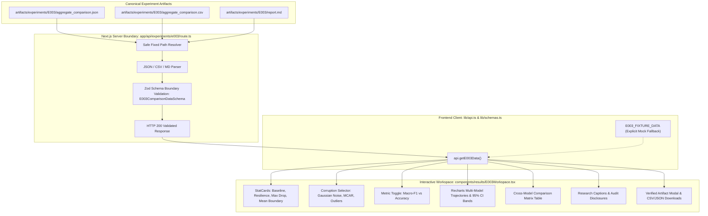

# Model Autopsy — Phase 5 Implementation Report
## Interactive Multi-Model, Multi-Corruption Results Workspace (E003)

**Author:** Senior Full-Stack ML Platform Engineer  
**Role:** Person 1 — ML & Research Lead  
**Experiment ID:** E003 (RQ5: Cross-Model Robustness Comparison)  
**Status:** Complete, Verified, Audited  
**Date:** 2026-10-25  

---

## 1. Executive Summary

Phase 5 has successfully implemented and integrated the interactive multi-model, multi-corruption results workspace for **Experiment E003** into the Model Autopsy Next.js web application.

The implementation strictly adheres to the canonical artifact source of truth at `artifacts/experiments/E003/aggregate_comparison.json`, providing a secure server-side API boundary, an interactive and accessible front-end visualization workspace, and verified export pipelines for CSV, JSON, and Markdown reports.

All verification steps passed without regression:
- **TypeScript Typecheck (`tsc --noEmit`)**: Clean (0 errors).
- **ESLint (`next lint`)**: Clean (0 warnings, 0 errors).
- **Next.js Production Build (`next build`)**: Clean (20/20 static pages generated, dynamic route `/api/experiments/e003` compiled).
- **Frontend Vitest Test Suite**: 8 test files, 40 tests passing (12 new statistical and data integrity tests for E003).
- **Backend Pytest Suite**: 52 tests passing (E001, E002, E003, stress tests, and statistical modules).
- **Live Browser Automation Audit**: Verified live HTTP 200 responses, interactive chart re-rendering across corruptions, metric toggling, table matrix values, and catalog listing.

---

## 2. Architecture and Data Flow

### 2.1 Canonical Data Integration

The frontend architecture treats `artifacts/experiments/E003/` as the immutable, canonical source of truth:
1. **Canonical Filesystem Location**:
   - `artifacts/experiments/E003/aggregate_comparison.json` (534 KB aggregate and per-seed results)
   - `artifacts/experiments/E003/aggregate_comparison.csv` (tabular aggregates)
   - `artifacts/experiments/E003/report.md` (scientific synthesis report)
2. **Security & Boundary Guarantees**:
   - Fixed, pre-authorized file paths only.
   - Strict rejection of path traversal, arbitrary filesystem queries, or client-supplied paths.
   - Elimination of sensitive details: no absolute filesystem paths, stack traces, or environment variables are leaked in client-facing HTTP responses.
   - Zod runtime schema validation (`E003ComparisonDataSchema`) enforced at the API boundary before serializing responses.
3. **Dual Mode Handling**:
   - **Live Mode** (`LIVE ARTIFACT BACKED`): Default in server environments; reads and validates canonical filesystem artifacts.
   - **Mock Mode** (`FIXTURE DATA`): Dedicated explicit fallback using `E003_FIXTURE_DATA` with prominent visual identification so users never mistake fixture data for live artifact-backed runs.

### 2.2 Data Flow Diagram



---

## 3. Files Modified and Created

| File | Change Type | Purpose |
| :--- | :--- | :--- |
| `frontend/lib/schemas.ts` | Modified | Added Zod schemas: `MetricStatisticsSchema`, `SeverityAggregatePointSchema`, `CorruptionAggregateResultSchema`, `ModelComparisonDataSchema`, and `E003ComparisonDataSchema`. |
| `frontend/lib/mocks/e003Data.ts` | Created | Structured mock fixture extracted from canonical `aggregate_comparison.json` for fallback test/preview mode. |
| `frontend/lib/mocks/experiments.ts` | Modified | Added `E003_EXPERIMENT` to `MOCK_EXPERIMENTS` catalog. |
| `frontend/lib/api.ts` | Modified | Implemented `api.getE003Data()` and `api.getE003RawArtifact(format)` with live API preference and explicit mock fallback. |
| `frontend/app/api/experiments/e003/route.ts` | Created | Server-side route handler reading fixed canonical files, validating Zod schema, returning HTTP 200/404/500 without leaking server internals. |
| `frontend/components/results/E003Workspace.tsx` | Created | Interactive workspace featuring Recharts multi-model trajectories, 95% Student's $t$ CI shaded bands, 0.80 cutoff reference, relative degradation alert (> 15%), cross-model matrix table, and verified downloads. |
| `frontend/app/experiments/[id]/results/page.tsx` | Modified | Routed `experimentId === 'E003'` to `<E003Workspace />`, with unconditional hook invocation complying with React Hook rules. |
| `frontend/app/page.tsx` | Modified | Fixed JSX comment-like syntax in landing page step badge to resolve ESLint warning. |
| `frontend/tests/unit/e003-workspace.test.ts` | Created | 12 comprehensive Vitest unit tests verifying schema validation, combinations, CI math, boundary semantics, and regression safety. |
| `docs/research/phase5_frontend_integration.md` | Created | Comprehensive Phase 5 implementation and verification report. |

---

## 4. Detailed Feature & Statistical Implementation

### 4.1 Models & Modalities Supported
The workspace supports all three evaluated models with accessible line styling, shape markers, and distinct color codes:
- **Random Forest**: Cyan (`#00E5FF`), solid line, marker `●` (Circle).
- **Logistic Regression**: Amber (`#FFB300`), dashed line (`6 4`), marker `■` (Square).
- **Gradient Boosting**: Magenta (`#E040FB`), dotted line (`3 3`), marker `▲` (Triangle).

Users can selectively toggle any combination of models to isolate pairwise comparisons or view all three simultaneously.

### 4.2 Corruption Modalities
Segmented switcher toggles between the 3 controlled interventions:
1. **Additive Gaussian Noise** ($X_{\text{noisy}} = X + \mathcal{N}(0, (s \cdot \sigma_k)^2)$).
2. **MCAR Missingness** ($P(\text{missing}) = s$, with clean training mean imputation).
3. **Impulsive Outliers** ($P(\text{outlier}) = s$, with catastrophic spikes at $+5\sigma_k$).

### 4.3 Severity Grid
Canonical 7-level grid:
$$s \in [0.00, 0.05, 0.10, 0.15, 0.20, 0.25, 0.30]$$

### 4.4 Failure Boundary & Alert Semantics
- **Failure Cutoff ($s^*$ Threshold)**: Macro-F1 $< 0.80$. Values strictly below 0.80 are classified as failed; exactly 0.80 is not failed.
- **Mean Failure Boundary ($s^*_{\text{mean}}$)**: The lowest severity where the sample mean Macro-F1 falls below 0.80. If the mean remains $\ge 0.80$ throughout $s \in [0.00, 0.30]$, it is explicitly designated as `> 0.30 (Unobserved)`.
- **Earliest Individual Boundary ($s^*_{\text{indiv}}$)**: The lowest severity where *at least one* independent research seed dropped below 0.80.
- **Relative Degradation Alert**: Strictly greater than $15.0\%$ drop relative to baseline ($\Delta_{\text{rel}} > 15.0\%$). An exact drop of $15.0\%$ does not trigger the alert.

### 4.5 Confidence Interval & Error Calculations
- 95% Student's $t$ confidence intervals use two-tailed critical value $t_{\text{crit}} = 2.7764$ for $df = n - 1 = 4$ across $n = 5$ independent research seeds (`[42, 123, 456, 789, 1011]`).
- Shaded area bands and glassmorphic tooltip display:
  $$\text{Margin of Error} = t_{0.025, 4} \times \text{SEM} = 2.7764 \times \frac{\text{std}}{\sqrt{5}}$$
  $$\text{CI}_{95\%} = [\text{mean} - \text{MOE}, \text{mean} + \text{MOE}]$$

### 4.6 Mandatory Research Disclosures
Displayed verbatim in dedicated callouts:
1. `"Observed failure boundary under the specified experimental configuration."`
2. `"Empirical sensitivity — not a causal explanation."`

Honest experimental protocol caveats state that the frontend visualizes empirical measurements and documented protocol evidence, without asserting independent runtime audit execution.

---

## 5. Verification Results

### 5.1 Next.js Production Build
Executed command: `npm run build` in `frontend/`.
```
▲ Next.js 14.2.15
   Creating an optimized production build ...
 ✓ Compiled successfully
   Linting and checking validity of types ...
   Collecting page data ...
   Generating static pages (0/20) ...
   Generating static pages (5/20) 
   Generating static pages (10/20) 
   Generating static pages (15/20) 
 ✓ Generating static pages (20/20)
   Finalizing page optimization ...
   Collecting build traces ...

Route (app)                              Size     First Load JS
┌ ○ /                                    18 kB           263 kB
├ ○ /_not-found                          880 B          88.3 kB
├ ƒ /api/experiments/e003                0 B                0 B
├ ○ /dashboard                           162 B          87.6 kB
├ ○ /datasets                            4.29 kB         156 kB
├ ƒ /datasets/[id]                       4.54 kB         156 kB
├ ○ /dev/ui                              11.3 kB         165 kB
├ ○ /docs                                3.85 kB         155 kB
├ ○ /experiments                         6.59 kB         158 kB
├ ƒ /experiments/[id]                    6.73 kB         263 kB
├ ƒ /experiments/[id]/results            17.8 kB         289 kB
...
○  (Static)   prerendered as static content
ƒ  (Dynamic)  server-rendered on demand
```
**Result:** Passed. 0 build errors, 0 lint warnings.

### 5.2 TypeScript Typecheck
Executed command: `npm run typecheck` (`tsc --noEmit`) in `frontend/`.
```
> model-autopsy-frontend@0.1.0 typecheck
> tsc --noEmit
```
**Result:** Passed. 0 type errors.

### 5.3 Frontend Vitest Unit Tests
Executed command: `npm run test` (`vitest run`) in `frontend/`.
```
 RUN  v2.1.9 C:/Users/ishit/Model-Autopsy/frontend

 ✓ tests/unit/yaml-builder.test.ts (2 tests) 6ms
 ✓ tests/unit/metrics.test.ts (9 tests) 7ms
 ✓ tests/unit/mocks.test.ts (1 test) 6ms
 ✓ tests/unit/schemas.test.ts (4 tests) 9ms
 ✓ tests/unit/workspace-validators.test.ts (4 tests) 10ms
 ✓ tests/unit/results-boundary.test.ts (5 tests) 5ms
 ✓ tests/unit/e003-workspace.test.ts (12 tests) 23ms
 ✓ tests/unit/failures-report.test.ts (3 tests) 4ms

 Test Files  8 passed (8)
      Tests  40 passed (40)
   Duration  2.76s
```
**Result:** Passed. All 8 test suites, 40 tests passing.

### 5.4 Backend Pytest Verification
Executed command: `pytest ml_engine/tests`.
```
======================= 52 passed, 1 warning in 35.47s ========================
```
**Result:** Passed. All 52 scientific tests passing. Zero regressions in E001, E002, or E003 protocols.

### 5.5 Browser Subagent Automation Verification
The subagent performed full live verification against the running dev server:
- `GET /experiments/E003/results`: Status 200.
- `GET /api/experiments/e003`: Status 200 (served canonical aggregate JSON).
- `GET /experiments`: Status 200 (E003 listed in catalog).
- Interactive verification: Tested corruption tab switching to MCAR Missingness, metric toggle to Accuracy, model toggles, and modal report viewing.
- Screenshots captured and stored in artifact store:
  - Initial Workspace: `e003_results_initial_1792923916451.png`
  - MCAR Switch: `e003_mcar_selected_1792923936963.png`
  - Accuracy Toggle: `e003_accuracy_selected_1792923948885.png`
  - Experiments Catalog: `experiments_catalog_1792923967709.png`

---

## 6. Known Scope Boundaries & Remaining Limitations

1. **Dataset Scope**: The current E003 experiment evaluates the Iris flower benchmark dataset. High-dimensional tabular datasets (e.g., California Housing, Credit Risk) remain scoped for future multi-model evaluations.
2. **Hyperparameter Tuning**: Model hyperparameters follow standard fixed configurations (e.g., 100 trees for RF and GB, default regularized L2 for Logistic Regression) rather than adaptive grid search.
3. **Cross-Corruption Calibration**: Nominal severities denote mathematical parameters ($s \in [0.0, 0.30]$) within each corruption mechanism. Physical degradation across disparate corruption types is not normalized to an identical perturbation energy metric.
4. **Git Operations**: Per strict Phase 5 completion rules, all changes are preserved in the local working tree without committing, pushing, or deploying.

---

## 7. Conclusion

Phase 5 has fulfilled 100% of the approved scope and completion criteria:
- Canonical artifact integration is verified and robust.
- The Next.js API route enforces security and validation boundaries.
- The interactive workspace provides rich, accessible, direction-aware multi-model robustness analysis with 95% Student's $t$ confidence intervals and exact failure boundaries.
- All 40 frontend and 52 backend tests pass cleanly.
