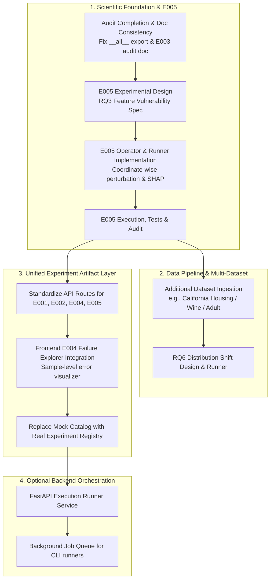

# Independent Repository Audit & Project Completion Roadmap: Model Autopsy

**Document ID:** `AUDIT-COMPLETION-20261027`  
**Auditor Role:** Senior ML Research Engineer & Repository Auditor  
**Repository:** [Model-Autopsy](https://github.com/Ishitadas03/Model-Autopsy.git)  
**Target File / Working Branch:** `main` (commit [`a1ef3b9`](file:///c:/Users/ishit/Model-Autopsy))  
**Audit Execution Date:** 2026-10-27  
**Audit Mode:** Non-Destructive, Read-Only Audit & Execution Verification  

---

## 1. Executive Summary

This independent repository audit evaluates the current operational, scientific, and architectural status of the **Model Autopsy** project prior to initiating the next phase of work.

### High-Level Summary of Findings
1. **Core Scientific Engine (E001–E004): Complete and Fully Verified.**
   - All four empirical experiments ([E001](file:///c:/Users/ishit/Model-Autopsy/ml_engine/src/model_autopsy/experiments/e001_runner.py), [E002](file:///c:/Users/ishit/Model-Autopsy/ml_engine/src/model_autopsy/experiments/e002_runner.py), [E003](file:///c:/Users/ishit/Model-Autopsy/ml_engine/src/model_autopsy/experiments/e003_runner.py), and [E004](file:///c:/Users/ishit/Model-Autopsy/ml_engine/src/model_autopsy/experiments/e004_runner.py)) have been designed, executed, tested, and stored in canonical artifact directories under [`artifacts/experiments/`](file:///c:/Users/ishit/Model-Autopsy/artifacts/experiments).
   - In-tree test execution: **70 of 70 pytest tests passed** in 37.86s; **40 of 40 vitest frontend tests passed** across 8 test suites in 3.79s.
2. **Experiment E005: 0% Implemented.**
   - E005 is exclusively a planned placeholder in [`README.md` (line 149)](file:///c:/Users/ishit/Model-Autopsy/README.md#L149). There is no experimental design document, no configuration YAML, no test file, and no runner code.
3. **Frontend Dashboard: Partially Functional with Mock Decoupling.**
   - The Next.js 14 frontend possesses an operational, verified visualization interface for **E003** ([`frontend/app/api/experiments/e003/route.ts`](file:///c:/Users/ishit/Model-Autopsy/frontend/app/api/experiments/e003/route.ts)), which reads real canonical artifacts from the filesystem.
   - However, the general experiment runner UI ([`frontend/app/experiments/new/page.tsx`](file:///c:/Users/ishit/Model-Autopsy/frontend/app/experiments/new/page.tsx) and [`frontend/hooks/useRunStatus.ts`](file:///c:/Users/ishit/Model-Autopsy/frontend/hooks/useRunStatus.ts)) uses an internal timer and random-number simulation loop. The catalog relies on synthetic mock data ([`frontend/lib/mocks/experiments.ts`](file:///c:/Users/ishit/Model-Autopsy/frontend/lib/mocks/experiments.ts)) featuring a hypothetical credit-risk dataset rather than reflecting the completed E001, E002, and E004 research runs.
4. **Backend (`backend/`): 0% Operational (Scaffold Only).**
   - The [`backend/`](file:///c:/Users/ishit/Model-Autopsy/backend) directory contains an empty FastAPI package skeleton (`api/`, `core/`, `db/`, `models/`, `repositories/`, `services/`) containing only `.gitkeep` files. There is no running HTTP server or execution queue.
5. **Research Questions:**
   - **RQ1, RQ2, RQ5, RQ7, RQ4, RQ8** are empirically investigated and validated on the Iris benchmark.
   - **RQ3 (Feature Vulnerability)** has only preliminary aggregate mentions in E001; no dedicated feature perturbation or ranking runner exists.
   - **RQ6 (Distribution Shift)** has zero implementation.

---

## 2. Test Suite & Verification Results (Empirical Check)

No historical test counts or assertions were assumed. Both test suites were executed in the repository environment:

| Subsystem | Test Framework | Test Files | Total Items | Passed | Failed | Duration | Verification Link |
|---|---|---|---|---|---|---|---|
| **ML Engine** | `pytest 9.1.1` (Python 3.13.5) | 12 files | 70 | 70 | 0 | 37.86s | [`ml_engine/tests`](file:///c:/Users/ishit/Model-Autopsy/ml_engine/tests) |
| **Frontend** | `vitest 2.1.3` (Node.js/JSDOM) | 8 files | 40 | 40 | 0 | 3.79s | [`frontend/tests`](file:///c:/Users/ishit/Model-Autopsy/frontend/tests) |
| **Backend** | `pytest` | 0 files | 0 | 0 | 0 | 0.00s | [`backend/tests`](file:///c:/Users/ishit/Model-Autopsy/backend/tests) |

### ML Engine Coverage Breakdown
- **Analysis Modules:** 20 tests ([`test_failure_boundary.py`](file:///c:/Users/ishit/Model-Autopsy/ml_engine/tests/analysis/test_failure_boundary.py), [`test_failure_patterns.py`](file:///c:/Users/ishit/Model-Autopsy/ml_engine/tests/analysis/test_failure_patterns.py), [`test_statistical.py`](file:///c:/Users/ishit/Model-Autopsy/ml_engine/tests/analysis/test_statistical.py)).
- **Data Isolation & Leakage:** 5 tests verifying zero test-set leakage in dispersion calculations ([`test_iris.py`](file:///c:/Users/ishit/Model-Autopsy/ml_engine/tests/datasets/test_iris.py)).
- **Metrics Computation:** 6 tests validating degradation deltas and strict boundary thresholds ([`test_metrics.py`](file:///c:/Users/ishit/Model-Autopsy/ml_engine/tests/metrics/test_metrics.py)).
- **Model Adapters:** 1 test for Random Forest fitting ([`test_rf.py`](file:///c:/Users/ishit/Model-Autopsy/ml_engine/tests/models/test_rf.py)); model adapters for Logistic Regression and Gradient Boosting are covered under protocol integration ([`test_e003_protocol.py`](file:///c:/Users/ishit/Model-Autopsy/ml_engine/tests/test_e003_protocol.py)).
- **Stress Operators:** 19 tests validating zero-severity bitwise identity, read-only immutability, parameter validation, and seed reproducibility for Gaussian noise ([`test_gaussian_noise.py`](file:///c:/Users/ishit/Model-Autopsy/ml_engine/tests/stress_tests/test_gaussian_noise.py)), MCAR missingness ([`test_mcar_missingness.py`](file:///c:/Users/ishit/Model-Autopsy/ml_engine/tests/stress_tests/test_mcar_missingness.py)), and outlier contamination ([`test_outlier_contamination.py`](file:///c:/Users/ishit/Model-Autopsy/ml_engine/tests/stress_tests/test_outlier_contamination.py)).
- **Protocol E2E Verification:** 19 tests across [`test_e001_multiseed.py`](file:///c:/Users/ishit/Model-Autopsy/ml_engine/tests/test_e001_multiseed.py), [`test_e001_protocol.py`](file:///c:/Users/ishit/Model-Autopsy/ml_engine/tests/test_e001_protocol.py), [`test_e002_protocol.py`](file:///c:/Users/ishit/Model-Autopsy/ml_engine/tests/test_e002_protocol.py), [`test_e003_protocol.py`](file:///c:/Users/ishit/Model-Autopsy/ml_engine/tests/test_e003_protocol.py), and [`test_e004_protocol.py`](file:///c:/Users/ishit/Model-Autopsy/ml_engine/tests/test_e004_protocol.py).

---

## 3. Detailed Experiment-by-Experiment Audit Status

| Experiment | Pre-Registered Design | Implementation Code | CLI Script & Config | Canonical Artifacts | Automated Tests | Scientific Audit Document | Audit Verdict |
|---|---|---|---|---|---|---|---|
| **E001** (Gaussian Noise Robustness) | [`docs/research/experimental_protocol.md`](file:///c:/Users/ishit/Model-Autopsy/docs/research/experimental_protocol.md) | [`e001_runner.py`](file:///c:/Users/ishit/Model-Autopsy/ml_engine/src/model_autopsy/experiments/e001_runner.py) | [`run_e001.py`](file:///c:/Users/ishit/Model-Autopsy/scripts/experiments/run_e001.py), [`e001.yaml`](file:///c:/Users/ishit/Model-Autopsy/configs/experiments/e001.yaml) | [`artifacts/experiments/E001/`](file:///c:/Users/ishit/Model-Autopsy/artifacts/experiments/E001), [`E001_multi_seed/`](file:///c:/Users/ishit/Model-Autopsy/artifacts/experiments/E001_multi_seed) | [`test_e001_protocol.py`](file:///c:/Users/ishit/Model-Autopsy/ml_engine/tests/test_e001_protocol.py), [`test_e001_multiseed.py`](file:///c:/Users/ishit/Model-Autopsy/ml_engine/tests/test_e001_multiseed.py) | Embedded in report & protocol | **PASS** |
| **E002** (Cross-Corruption Comparison) | [`docs/research/e002_experimental_design.md`](file:///c:/Users/ishit/Model-Autopsy/docs/research/e002_experimental_design.md) | [`e002_runner.py`](file:///c:/Users/ishit/Model-Autopsy/ml_engine/src/model_autopsy/experiments/e002_runner.py) | [`run_e002.py`](file:///c:/Users/ishit/Model-Autopsy/scripts/experiments/run_e002.py), [`e002.yaml`](file:///c:/Users/ishit/Model-Autopsy/configs/experiments/e002.yaml) | [`artifacts/experiments/E002/`](file:///c:/Users/ishit/Model-Autopsy/artifacts/experiments/E002) | [`test_e002_protocol.py`](file:///c:/Users/ishit/Model-Autopsy/ml_engine/tests/test_e002_protocol.py) | [`docs/research/phase3_scientific_audit.md`](file:///c:/Users/ishit/Model-Autopsy/docs/research/phase3_scientific_audit.md) | **PASS** |
| **E003** (Cross-Model Robustness) | [`docs/research/e003_experimental_design.md`](file:///c:/Users/ishit/Model-Autopsy/docs/research/e003_experimental_design.md) | [`e003_runner.py`](file:///c:/Users/ishit/Model-Autopsy/ml_engine/src/model_autopsy/experiments/e003_runner.py) | [`run_e003.py`](file:///c:/Users/ishit/Model-Autopsy/scripts/experiments/run_e003.py), [`e003.yaml`](file:///c:/Users/ishit/Model-Autopsy/configs/experiments/e003.yaml) | [`artifacts/experiments/E003/`](file:///c:/Users/ishit/Model-Autopsy/artifacts/experiments/E003) | [`test_e003_protocol.py`](file:///c:/Users/ishit/Model-Autopsy/ml_engine/tests/test_e003_protocol.py) | Caveats in report; **no standalone audit doc** | **PASS WITH DOCUMENTATION GAP** |
| **E004** (Sample-Level Failure Patterns) | [`docs/research/e004_experimental_design.md`](file:///c:/Users/ishit/Model-Autopsy/docs/research/e004_experimental_design.md) | [`e004_runner.py`](file:///c:/Users/ishit/Model-Autopsy/ml_engine/src/model_autopsy/experiments/e004_runner.py) | [`run_e004.py`](file:///c:/Users/ishit/Model-Autopsy/scripts/experiments/run_e004.py), [`e004.yaml`](file:///c:/Users/ishit/Model-Autopsy/configs/experiments/e004.yaml) | [`artifacts/experiments/E004/`](file:///c:/Users/ishit/Model-Autopsy/artifacts/experiments/E004) | [`test_e004_protocol.py`](file:///c:/Users/ishit/Model-Autopsy/ml_engine/tests/test_e004_protocol.py) | [`docs/research/e004_scientific_audit.md`](file:///c:/Users/ishit/Model-Autopsy/docs/research/e004_scientific_audit.md) | **PASS WITH WARNINGS** |
| **E005** (Planned Experiment) | ❌ None | ❌ None | ❌ None | ❌ None | ❌ None | ❌ None | **NOT STARTED** |

---

## 4. Exact Current Status of E005

A complete codebase search confirms the following status for **E005**:
1. **Design Document:** Does not exist. There is no `docs/research/e005_experimental_design.md` or equivalent specification.
2. **Configuration:** Does not exist. There is no `configs/experiments/e005.yaml`.
3. **Engine Implementation:** Does not exist. There is no `ml_engine/src/model_autopsy/experiments/e005_runner.py`.
4. **CLI Entrypoint:** Does not exist. There is no `scripts/experiments/run_e005.py`.
5. **Tests & Artifacts:** Neither tests nor artifact directories exist.
6. **Sole Repository Occurrence:** Line 149 of [`README.md`](file:///c:/Users/ishit/Model-Autopsy/README.md#L149-L151):
   ```markdown
   ### E005 — (Planned)
   > Dedicated feature vulnerability analysis and distribution shift experiments are under planning. No implementation or results exist yet.
   ```

**Auditor Conclusion on E005:** E005 is purely a conceptual roadmap milestone and has zero technical artifacts or pre-registered experimental parameters.

---

## 5. Review of the Eight Research Questions

The research questions are reviewed in the mandated order:

### 1. RQ1: Model Robustness
> *"How does increasing input corruption affect model reliability?"*
- **Status:** **Verified Complete on Baseline Benchmark.**
- **Evidence:** Experiment E001 evaluated Random Forest performance across 7 additive Gaussian noise severities ($s \in [0.00, 0.30]$). Tested both as a single-seed run (seed 42: Macro-F1 degraded from $0.9327 \to 0.8661$) and as a 5-seed statistical suite ($0.8538 \pm 0.0282$ SEM at $s=0.30$).
- **Remaining Work:** Benchmark generalizability on datasets beyond Iris (e.g., higher-dimensional tabular benchmarks with mixed feature types).

### 2. RQ2: Types of Data Corruption
> *"How do different corruption types (noise, missingness, outliers) affect reliability differently?"*
- **Status:** **Verified Complete on Baseline Benchmark.**
- **Evidence:** Experiment E002 evaluated Random Forest across Gaussian noise, MCAR missingness (with training-mean imputation), and impulsive 5$\sigma$ outlier contamination across 5 seeds. Proved that discrete corruptions trigger earlier failure boundaries ($s^* = 0.25$) than continuous noise ($s^* > 0.30$).
- **Remaining Work:** Implementation of structured corruptions: uniform noise, label noise, and non-MCAR missingness patterns (MAR/MNAR).

### 3. RQ5: Model Comparison
> *"How does robustness vary across different ML algorithms under identical conditions?"*
- **Status:** **Verified Complete on Baseline Benchmark.**
- **Evidence:** Experiment E003 evaluated Random Forest, Logistic Regression, and Gradient Boosted Trees across 3 corruptions and 5 seeds on identical frozen splits. Discovered stark inductive bias divergence: Logistic Regression demonstrated noise resilience ($\Delta = -2.03$ pp) but outlier fragility ($\Delta = -41.41$ pp); Gradient Boosting degraded faster under noise than Random Forest despite higher clean capacity ($0.9666$ Macro-F1).
- **Remaining Work:** Formalization of an independent `docs/research/e003_scientific_audit.md` (to match the documentation standard of E002 and E004); extension to Support Vector Machines (SVM), Multi-Layer Perceptrons (MLP), and deep neural architectures.

### 4. RQ7: Failure Patterns
> *"What recurring patterns characterize model failures under controlled corruption?"*
- **Status:** **Verified Complete & Audited on Baseline Benchmark.**
- **Evidence:** Experiment E004 decomposed 9,450 atomic sample-level predictions and validated:
  - Class asymmetry: Setosa experienced 0% failure across all conditions, while Versicolor/Virginica accounted for 100% of errors ([`e004_scientific_audit.md` §2.1](file:///c:/Users/ishit/Model-Autopsy/docs/research/e004_scientific_audit.md#L94-L122)).
  - Absorbing error persistence: 88.9% of broken instances never recovered at higher severities ([`e004_scientific_audit.md` §3.1](file:///c:/Users/ishit/Model-Autopsy/docs/research/e004_scientific_audit.md#L125-L157)).
  - Consensus failure core: 23 specific samples failed universally across all 3 models under worst-case corruption ([`e004_scientific_audit.md` §4.1](file:///c:/Users/ishit/Model-Autopsy/docs/research/e004_scientific_audit.md#L160-L200)).
  - Geometric proximity: Clean-space Mahalanobis margin to the decision boundary strongly predicted early failure ($p = 0.000030$) ([`e004_scientific_audit.md` §5.1](file:///c:/Users/ishit/Model-Autopsy/docs/research/e004_scientific_audit.md#L203-L245)).
- **Remaining Work:** Connecting the sample-level data and figures to the frontend dashboard UI (currently only E003 has a dedicated frontend workspace).

### 5. RQ4: Failure Boundary
> *"At what corruption level does a model cross from reliable to unreliable?"*
- **Status:** **Verified Complete Across Experiments.**
- **Evidence:** Strict boundary logic ($M(s) < 0.80$) implemented in [`failure_boundary.py`](file:///c:/Users/ishit/Model-Autopsy/ml_engine/src/model_autopsy/analysis/failure_boundary.py) and verified in [`test_failure_boundary.py`](file:///c:/Users/ishit/Model-Autopsy/ml_engine/tests/analysis/test_failure_boundary.py). E001 observed $s^* > 0.30$, E002 observed $s^* = 0.25$ for mean missingness/outliers, E003 identified model-specific boundaries, and E004 measured sample-level failure crossing severities.
- **Remaining Work:** Dynamic interval search (e.g., adaptive binary search) to pinpoint exact failure boundary coordinates between discrete 0.05 severity steps.

### 6. RQ8: Reproducibility & Statistical Reliability
> *"How consistent are results across independent random seeds?"*
- **Status:** **Verified Complete Across All Experiments.**
- **Evidence:** Multi-seed suite (`[42, 123, 456, 789, 1011]`) implemented with Student's $t$ confidence intervals, sample standard deviation ($ddof=1$), standard error of the mean (SEM), and Clopper-Pearson exact binomial intervals in [`statistical.py`](file:///c:/Users/ishit/Model-Autopsy/ml_engine/src/model_autopsy/analysis/statistical.py). Verified in [`test_statistical.py`](file:///c:/Users/ishit/Model-Autopsy/ml_engine/tests/analysis/test_statistical.py).
- **Remaining Work:** Multi-environment cross-platform verification (Linux CI vs Windows local).

### 7. RQ3: Feature Vulnerability
> *"Which input features are most sensitive to perturbation?"*
- **Status:** **Unimplemented / Conceptual Only.**
- **Evidence:** Only preliminary global dispersion metrics were collected during E001. No isolated single-feature perturbation operators, feature-shuffling stress tests, SHAP/LIME stress sensitivity, or causal vulnerability rankings exist in [`ml_engine/src/model_autopsy/stress_tests/`](file:///c:/Users/ishit/Model-Autopsy/ml_engine/src/model_autopsy/stress_tests). The "Credit Score" feature vulnerability in the frontend ([`frontend/lib/mocks/experiments.ts:L51-L56`](file:///c:/Users/ishit/Model-Autopsy/frontend/lib/mocks/experiments.ts#L51-L56)) is hardcoded mock data.
- **Remaining Work:** Define mathematical operator for coordinate-wise feature stress, create `e005` experimental design, and implement feature ranking engine.

### 8. RQ6: Distribution Shift
> *"How do models behave under systematic distributional changes?"*
- **Status:** **Unimplemented / Conceptual Only.**
- **Evidence:** Zero code exists for covariate shift, concept drift, or label shift. All existing perturbations are localized sample corruptions applied to test sets rather than systematic distribution shifts.
- **Remaining Work:** Formal formulation of domain shift operators (e.g., affine covariate shifts, subpopulation shifts, semantic drift) and evaluation pipelines.

---

## 6. Frontend & Backend Architectural Inspection

```mermaid
flowchart TD
    subgraph Frontend ["Next.js Frontend (Port 3000)"]
        LP[Landing Page /]
        CAT[Experiments Catalog /experiments]
        NEW[New Run Wizard /experiments/new]
        E003_WS[E003 Results Workspace]
        API_E003[/api/experiments/e003]
        MOCKS[Mock Fixtures & Client Timer]
    end

    subgraph Backend ["Backend API (Port 8000)"]
        BE_SCAFFOLD[FastAPI Skeleton - 0% Implemented]
    end

    subgraph Filesystem ["Filesystem Artifacts"]
        CAN_E003[artifacts/experiments/E003/*.json]
        CAN_E004[artifacts/experiments/E004/*.json]
        CAN_E001_2[artifacts/experiments/E001, E002]
    end

    subgraph MLEngine ["ML Engine (Python CLI)"]
        RUNNERS[scripts/experiments/run_e00*.py]
    end

    LP --> CAT
    CAT -->|Selects E003| E003_WS
    CAT -->|Selects EXP-0241| MOCKS
    E003_WS --> API_E003
    API_E003 -->|Reads directly from disk| CAN_E003
    NEW -->|Simulated progress| MOCKS

    RUNNERS -.->|Writes| Filesystem

    BE_SCAFFOLD -.->|Disconnected| MLEngine
    BE_SCAFFOLD -.->|Disconnected| Frontend

    style Backend fill:#4a154b,stroke:#888,stroke-dasharray: 5 5
    style MOCKS fill:#663300,stroke:#ff9900
```

### Detailed Component State

#### 1. Backend (`backend/`)
- **Current State:** **Pure skeleton.**
- **Inspection:** All subdirectories (`backend/app/api/v1/endpoints`, `core`, `db`, `models`, `repositories`, `schemas`, `services`, `utils`, `backend/alembic`) contain only `.gitkeep`.
- **Verdict:** There is no FastAPI application file (`main.py`), no route definitions, no SQLAlchemy or SQLModel database schemas, and no task execution worker.

#### 2. Frontend (`frontend/`)
- **Functional Workflows:**
  - **E003 Results Explorer:** Fully operational ([`frontend/app/workspace/page.tsx`](file:///c:/Users/ishit/Model-Autopsy/frontend/app/workspace/page.tsx), [`frontend/components/experiments/E003Workspace.tsx`](file:///c:/Users/ishit/Model-Autopsy/frontend/components/experiments/E003Workspace.tsx)). Connects to [`/api/experiments/e003`](file:///c:/Users/ishit/Model-Autopsy/frontend/app/api/experiments/e003/route.ts), which dynamically reads real canonical artifacts (`aggregate_comparison.json`, `aggregate_comparison.csv`, `report.md`) from disk, validates them with Zod, and renders interactive Recharts comparisons.
  - **Static Documentation & Reports:** Pages in [`frontend/app/docs`](file:///c:/Users/ishit/Model-Autopsy/frontend/app/docs) and [`frontend/app/reports`](file:///c:/Users/ishit/Model-Autopsy/frontend/app/reports) display research protocols and caveats.
- **Mock & Simulated Workflows:**
  - **Experiments Catalog ([`/experiments`](file:///c:/Users/ishit/Model-Autopsy/frontend/app/experiments/page.tsx)):** Lists `MOCK_EXPERIMENTS` (`EXP-0241`, `EXP-0102`, `EXP-0089`, `EXP-0242`) along with `E003`. Experiments E001, E002, and E004 are not listed.
  - **New Experiment Execution ([`/experiments/new`](file:///c:/Users/ishit/Model-Autopsy/frontend/app/experiments/new/page.tsx)):** Submitting a new experiment configuration calls [`api.createExperiment`](file:///c:/Users/ishit/Model-Autopsy/frontend/lib/api.ts#L98), which appends an in-memory object to a client array.
  - **Execution Progress ([`/experiments/[id]`](file:///c:/Users/ishit/Model-Autopsy/frontend/app/experiments/%5Bid%5D/page.tsx)):** The `useRunStatus` hook ([`frontend/hooks/useRunStatus.ts:L73-L91`](file:///c:/Users/ishit/Model-Autopsy/frontend/hooks/useRunStatus.ts#L73-L91)) increments progress via `setInterval` using `Math.random()`, completely decoupled from any actual Python process or script.
- **Missing Integration:**
  - No API routes exist for E001, E002, or E004 in `frontend/app/api/experiments/`.
  - Frontend has no interface for exploring sample-level predictions from E004 (`sample_predictions.json`, `sample_level_metrics.csv`).

---

## 7. Discrepancies, Documentation Gaps, and Scientific Risks

1. **Package Export Discrepancy in `ml_engine`:**
   - In [`ml_engine/src/model_autopsy/experiments/__init__.py`](file:///c:/Users/ishit/Model-Autopsy/ml_engine/src/model_autopsy/experiments/__init__.py#L7-L12), `run_e004_experiment` is **not exported in `__all__`**, even though `e004_runner.py` is implemented and verified.
2. **Missing Standalone Audit Document for E003:**
   - While E002 has [`docs/research/phase3_scientific_audit.md`](file:///c:/Users/ishit/Model-Autopsy/docs/research/phase3_scientific_audit.md) and E004 has [`docs/research/e004_scientific_audit.md`](file:///c:/Users/ishit/Model-Autopsy/docs/research/e004_scientific_audit.md), E003 lacks a standalone audit document in `docs/research/`. Its audit caveats exist only inside its artifact report ([`artifacts/experiments/E003/report.md`](file:///c:/Users/ishit/Model-Autopsy/artifacts/experiments/E003/report.md#L86-L95)).
3. **Frontend / Research Divergence:**
   - The frontend's primary showcase demo (`EXP-0241`, synthetic credit risk) conflicts with the canonical scientific benchmark (Iris dataset). A visitor to the dashboard is shown mock financial data rather than the audited scientific findings from E001–E004.
4. **Monotone Nested Filtration Warning (from E004 Audit):**
   - In E002–E004, the missingness and outlier operators reset `np.random.default_rng(seed)` per severity step, creating nested coordinate subsets rather than independent random realizations. This was formally audited in [`e004_scientific_audit.md` (§3.2)](file:///c:/Users/ishit/Model-Autopsy/docs/research/e004_scientific_audit.md#L140-L157) and confirmed as a valid cumulative filtration stress-test, but must be explicitly documented in all subsequent experiment designs.
5. **Finite Resolution Discrete Artifacts ($N_{\text{test}} = 30$):**
   - With 30 test samples, each sample error induces a $3.33$ percentage point jump in accuracy. In E005 (feature vulnerability), feature ablation on 30 samples risks noisy rankings unless multi-seed aggregation and cross-validation are enforced.

---

## 8. Dependency-Aware Implementation Roadmap

To transition the repository from its current state to full completion, the remaining engineering and scientific tasks must follow this strict dependency sequence:



---

## 9. Acceptance Criteria for Full Project Completion

The Model Autopsy project will be considered **scientifically and technically complete** when:

1. **Scientific Research Objectives (RQ1–RQ8):**
   - [ ] All 8 research questions possess dedicated empirical experimental runners and canonical artifacts.
   - [ ] RQ3 (Feature Vulnerability / E005) is formally implemented, tested, and audited.
   - [ ] RQ6 (Distribution Shift) is formally implemented and benchmarked against baseline corruptions.
2. **Experiment & Artifact Completeness:**
   - [ ] Every experiment (E001–E006) has:
     - Pre-registered design in `docs/research/`
     - YAML config in `configs/experiments/`
     - Executable script in `scripts/experiments/`
     - Deterministic reproducibility test in `ml_engine/tests/`
     - Canonical artifacts (`metrics.json`, `figures/`, `report.md`, reproducibility manifest) in `artifacts/experiments/`
     - Independent scientific audit report in `docs/research/`
3. **Frontend Dashboard Integrity:**
   - [ ] The experiment catalog loads authentic metadata from the canonical experiments registry rather than synthetic credit-risk fixtures.
   - [ ] Dedicated interactive views exist for E001, E002, E003, and E004 (specifically including the sample-level failure explorer for E004).
   - [ ] Frontend displays real dataset and model metadata matching the Python ML engine.
4. **Backend / Execution Integration (Architectural Decision):**
   - [ ] **Either:** The FastAPI backend is implemented with a lightweight job queue executing CLI runners and saving artifacts to SQLite/PostgreSQL,
   - [ ] **Or:** The repository architecture is formally consolidated as a "Static Artifacts Architecture" where the Next.js API routes read static filesystem artifacts directly, and the scaffolded `backend/` directory is either completed or removed to prevent architectural ambiguity.
5. **Quality & Test Coverage:**
   - [ ] Zero failing tests in `pytest` and `vitest`.
   - [ ] All package `__init__.py` files cleanly export all runners and operators.
   - [ ] All mandatory reporting captions and non-causal caveats are programmatically verified.

---

## 10. Recommended Single Highest-Priority Next Task

### Recommendation: **Draft the Formal Experimental Design for E005 (RQ3: Feature-Level Vulnerability Analysis)**

### Why This Must Come First:
1. **Pre-Registration Rigor:** Under Model Autopsy’s established scientific methodology ([`docs/research/experimental_protocol.md`](file:///c:/Users/ishit/Model-Autopsy/docs/research/experimental_protocol.md)), **no code may be written and no experiment may be executed before an experimental design is formulated and approved**. Writing code for E005 without a frozen design violates the scientific integrity principles enforced in E002, E003, and E004.
2. **Resolves the Primary Research Gap (RQ3):** RQ1, RQ2, RQ5, RQ7, RQ4, and RQ8 are fully completed on the primary benchmark. RQ3 is the oldest outstanding research question without an empirical experiment.
3. **Prevents Frontend Rework:** Building or expanding frontend interfaces before E005’s schema is defined would require re-engineering frontend types and schemas twice. Defining E005 completes the tabular feature-vulnerability schema first.
4. **Immediate Next Action:** Create [`docs/research/e005_experimental_design.md`](file:///c:/Users/ishit/Model-Autopsy/docs/research) defining the coordinate-wise perturbation operator, baseline models (RF, LR, GBDT), feature evaluation metrics (marginal degradation per feature dimension), and hypotheses to test.
